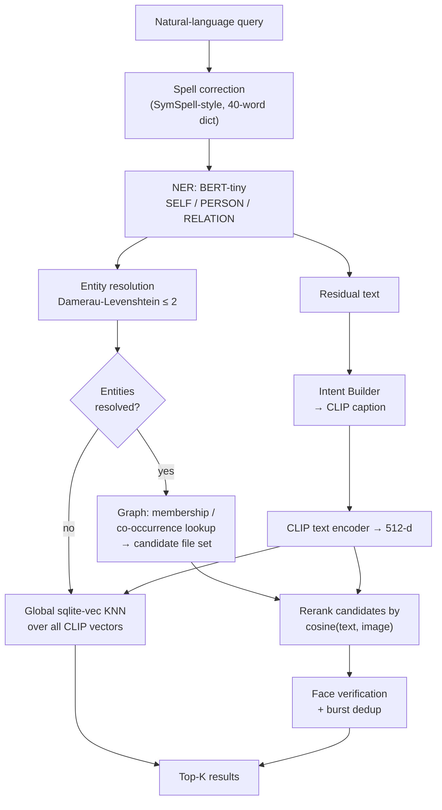

# 02 — Vanta From First Principles

## What problem does Vanta solve?

A typical phone holds 10,000–100,000 photos. The user's mental index of them is **episodic and relational**:

> "that photo of me and mom at the beach", "my graduation", "the dog running on the grass at the park"

The phone's index is **chronological and filename-based**. The gap between those two is the entire product.

Vanta lets you retrieve local media by typing the sentence you would say to a friend, and does it **entirely on
device** — no upload, no account, no network. Two constraints define everything downstream:

1. **Privacy is not a feature, it's the architecture.** The moment you allow a server call, CLIP-large, a reranker
   LLM and an ANN index with 100M vectors all become available and the engineering problem becomes ordinary. Refusing
   that is what makes the problem interesting.
2. **The compute budget is one phone, on battery, sharing the CPU with the OS.**

## Why is this technically difficult?

| Difficulty | Why it bites |
|---|---|
| **Open vocabulary** | You cannot enumerate the label set. "kedarnath", "holi", "my brother's graduation" are not ImageNet classes. This forces an *embedding* model, not a classifier. |
| **Identity is not semantics** | CLIP can tell you a photo contains "two people on a beach". It fundamentally cannot tell you *which* two people. Identity needs a separate, purpose-built model and its own index. |
| **Open-set identity** | The set of people is unknown at build time, changes over time, and has no labels. This is clustering, not classification — the hard version of the problem. |
| **Relational constraints** | "me AND mom" is a *conjunctive set constraint*, not a similarity query. Vector search optimises the wrong objective for it. |
| **Cold-start indexing cost** | 50k photos × (decode + CLIP + detect + N× embed) is hours of sustained compute on a device that thermally throttles and has a user watching the battery icon. |
| **No ground truth** | You cannot evaluate retrieval quality without labels, and the data is private by construction, so you cannot collect them centrally. |
| **Everything is quantised and approximated** | INT8 weights, FP16 activations, a 4M-param NER model, a 40-word spellchecker. Errors compound across six stages. |

## What would a naive photo-search system look like?

**Level 0 — filename and EXIF search.** `IMG_20240612_181233.jpg`. Useless: filenames carry no semantics.

**Level 1 — a fixed-label classifier.** Run MobileNet/EfficientNet, store top-k ImageNet-ish tags, do keyword match.

**Level 2 — CLIP + cosine KNN.** Embed every image with CLIP, embed the query text, return top-k nearest neighbours.

## Why is that insufficient?

Level 1 dies on open vocabulary: no tag set contains "kedarnath" or "my sister". It also cannot rank — a tag is
present or absent.

Level 2 is much better and is the *foundation* of Vanta, but it fails on exactly the queries people actually type:

| Query | What CLIP-only returns | Why |
|---|---|---|
| "me and mom at the beach" | Any beach photo with two people | CLIP has no identity signal. "me" and "mom" are near-meaningless tokens to it. |
| "photos of dad" | Random photos of men | Same. |
| "me and mom" (no scene) | Nothing useful — the query has almost no visual content | There is nothing for a *visual* similarity model to match on. |
| "just my brother, alone" | Photos with many people included | Negation and cardinality are not representable in a single embedding dot product. |

The deeper reason: **a single vector dot product is a soft, unconstrained similarity.** Set membership ("this photo
contains entity 7 AND entity 12") is a *hard constraint*. You cannot express a conjunctive hard constraint as a
nearest-neighbour query over one vector space without exploding the space combinatorially.

## What exactly does Vanta add?

Vanta adds a **second, structured index over identity**, and a query planner that decides which index to use.



The three signals and their division of labour — **this is the single most important idea in the project**:

| Component | Question it answers | Index it owns |
|---|---|---|
| **NER (BERT-tiny)** | *Which entities are mentioned in this sentence?* | none — it's a parser |
| **Entity graph (SQLite)** | *Which files contain these specific people, together?* | `entity_memberships`, `entity_relations`, `entity_relation_files` |
| **CLIP (ViT-B/32)** | *Which of these files look like the described scene?* | `clip_vec` (512-d, sqlite-vec) |
| **Reranker** | *How do I combine a hard set constraint with a soft similarity?* | — |

**The architectural claim:** identity is a *filter*, semantics is a *ranker*. Filtering first is both more correct
(it enforces the constraint exactly) and much cheaper (you rerank 40 candidates, not 100,000).

## The requirement → consequence chain

This is the reasoning framework to apply to every technology in this repo:

```
Requirement:   retrieve personal photos by natural-language description, including by person
Constraint:    100% offline, private, on a mid-range Android phone, on battery
      ↓
Decision 1:    open-vocabulary image-text embeddings   → CLIP ViT-B/32 (FP16)
Decision 2:    open-set identity                       → SCRFD detect + ArcFace embed + online clustering
Decision 3:    relational constraints                  → entity/co-occurrence tables in SQLite
Decision 4:    map words → entities                    → tiny BERT token classifier + fuzzy resolution
Decision 5:    one store for vectors + relations + ACID → SQLite + sqlite-vec
Decision 6:    heavy compute close to the models       → C++ engine behind JNI
Decision 7:    fast UI iteration, one codebase         → React Native + Expo
      ↓
Consequences:  semantic retrieval works; identity retrieval works when clustering is right;
               compositional / counting / negation queries do not work;
               indexing is expensive and thermally bounded;
               clustering errors propagate into search results and are user-visible
      ↓
Improvements:  quality-gated clustering, multi-exemplar identities, score fusion,
               a real evaluation harness   (see 22_ARCHITECTURAL_IMPROVEMENTS.md)
```

## Scope: what Vanta is and is not

**Is:** an Android (arm64-v8a) app that indexes local images, clusters faces into named people, and answers
natural-language queries over them, fully offline.

**Is not:** cross-platform (iOS is a stub), a document search engine (not implemented), a video search engine
(not implemented), or a system with any evaluation harness behind its accuracy or latency claims.

Being precise about that boundary is not a weakness in an interview — it is the single clearest signal that you
actually know your own system.
