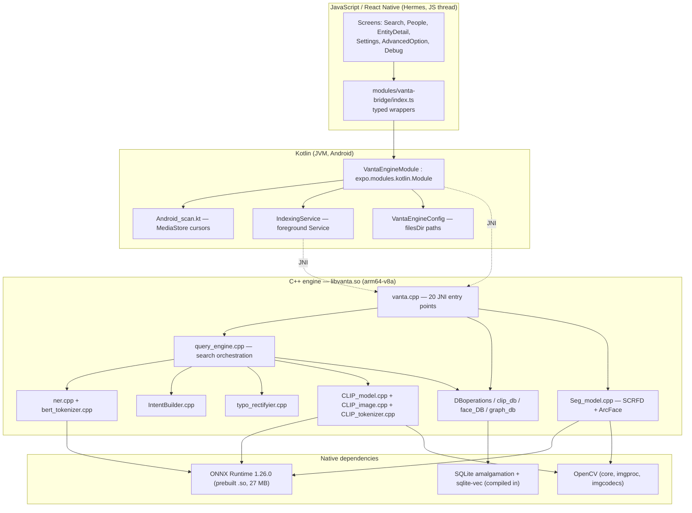
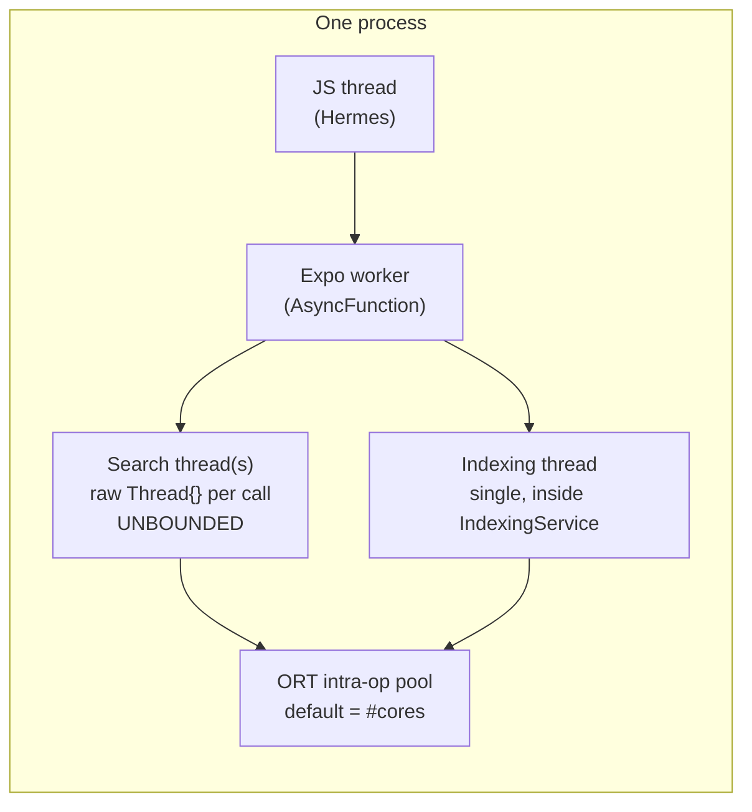
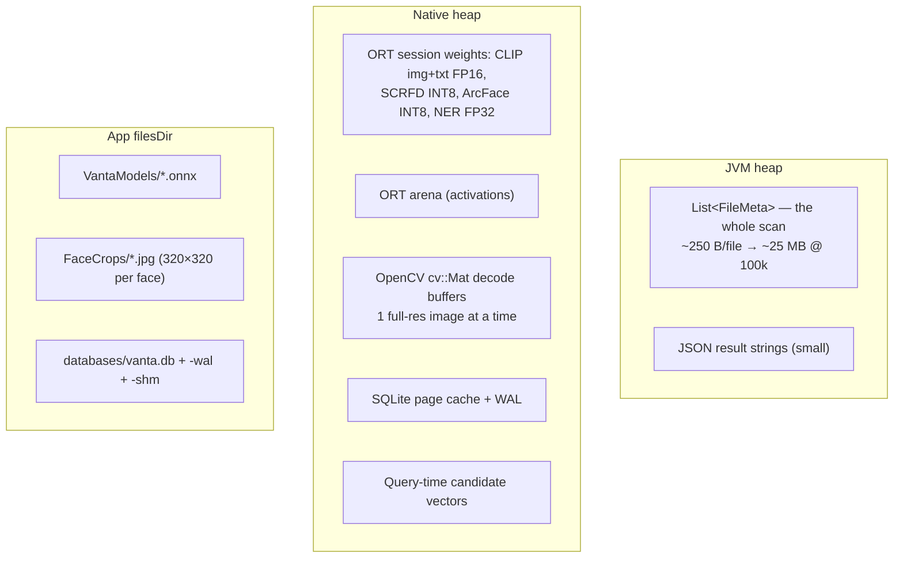

# 03 — System Architecture

> Every layer, every boundary. For each arrow: what crosses, in what representation, who owns the memory, what gets
> copied, which thread runs it, and what happens when it fails.

---

## 1. Component map



**Verified scale:** ~4,500 lines of hand-written C++, ~1,200 lines of Kotlin, ~2,300 lines of TypeScript/TSX.

---

## 2. Search path — boundary by boundary

```
User keystroke → SearchScreen → index.ts → Expo AsyncFunction → Kotlin Thread
  → searchImagesNative (JNI) → search_images() → [typo → NER → resolve → graph → CLIP → rerank]
  → JSON string → JNI → Kotlin → Promise → JSON.parse → setState → FlatGrid
```

| # | Boundary | What crosses | Representation | Ownership / copies | Thread | On failure |
|---|---|---|---|---|---|---|
| 1 | `SearchScreen` → `index.ts` | query string | JS `string` | JS heap | **JS thread** | `useVantaError` → `Alert.alert` |
| 2 | `index.ts` → Expo module | query string | JSI/Expo Modules marshalling | copied JS→JVM as `java.lang.String` | JS thread → Expo worker | Promise rejects |
| 3 | Kotlin `AsyncFunction` → new `Thread{}` | closure | — | — | **new raw Java thread per search** | uncaught → `promise.reject` |
| 4 | Kotlin → JNI `searchImagesNative` | `dbPath`, `query` | `jstring` ×2 | `GetStringUTFChars` → **copy** into `std::string`, immediately `Release`d | that Java thread, attached to JVM by the runtime | returns `"[]"` |
| 5 | JNI → `search_images()` | `std::string`, raw ptrs to globals | C++ | engine owns everything; `g_clip_session`, `g_tokenizer`, `g_ner_model` are process-lifetime leaked singletons | same | returns empty vector |
| 6 | engine → SQLite | SQL text + bound blobs | `sqlite3_stmt` | new **read-only** connection per call, closed before return | same | logs, returns `"[]"` |
| 7 | engine → ONNX Runtime | `Ort::Value` over a `std::vector` the caller owns | tensors are **non-owning views** — the backing vector must outlive `Run()` | ORT owns outputs | same (ORT may fan out internally) | `Ort::Exception` → caught → `"[]"` |
| 8 | `search_images` → JNI | `std::vector<search_result>` | struct | by value | same | — |
| 9 | JNI → Kotlin | **one `jstring` of hand-built JSON** | `env->NewStringUTF(json.c_str())` — copies into a **local ref** | JVM owns; local ref auto-freed on return | same | `"[]"` |
| 10 | Kotlin → JS | `String` | Expo marshalling | copy | Expo worker → JS | Promise rejects |
| 11 | JS | `JSON.parse` | JS objects | JS heap | JS thread | try/catch |

### Notes an interviewer will probe

- **Why a JSON string and not a structured Expo record?** It is one `NewStringUTF` instead of building N `HashMap`
  objects with `FindClass`/`GetMethodID`/`CallObjectMethod` per field. It is far less JNI code and far fewer local
  refs. **Cost:** the contract is untyped and has already drifted — `SearchScreen.tsx` declares
  `{ size?, date_taken?, file_type? }` while C++ emits `{ file_id, abs_path, display_name, size_bytes, mtime_unix,
  distance }`. Nothing catches that. *(Verified: `SearchResultItem` vs `vanta.cpp::searchImagesNative`.)*
- **JSON is escaped**, via `json_utils.hpp` `json_string_field()` — file paths can contain quotes and backslashes.
  This was clearly a bug that got fixed; the comment in `searchImagesNative` says so.
- **Concurrency hazard:** step 3 spawns an unbounded raw thread per search with no debounce or cancellation. Combined
  with the unsynchronised tokenizer load (see [01 §C3](./01_VANTA_REALITY_CHECK.md)) this is the app's sharpest
  threading edge.

---

## 3. Indexing path — boundary by boundary

```mermaid
sequenceDiagram
    participant JS as React Native
    participant K as Kotlin Module
    participant MS as MediaStore
    participant S as IndexingService
    participant C as C++ engine
    participant D as SQLite

    JS->>K: startStoring()
    K->>MS: contentResolver.query(Images/Video/Audio/Files)
    MS-->>K: Cursor rows (lazy Sequence, batch 200)
    K->>K: accumulate ALL into List<FileMeta>
    K->>C: startStoring(dbPath, FileMeta[N])  %% ONE JNI call
    C->>D: BEGIN; INSERT OR IGNORE × N; COMMIT
    C-->>K: jboolean
    JS->>K: generateEmbeddings()
    K->>S: startForegroundService(ACTION_START)
    S->>S: extractAssetsIfNeeded() (APK assets → filesDir)
    S->>C: generateEmbeddingsNative(dbPath)  %% ONE JNI call, long-running
    loop until no pending rows or paused
        C->>D: SELECT … WHERE filetype='picture' AND status='pending' LIMIT 10
        loop each image
            C->>C: imread → 224×224 → CLIP → 512-d
            C->>D: INSERT INTO clip_vec; UPDATE files SET status='indexed'
            C->>C: imdecode → SCRFD → NMS → align 112×112 → ArcFace ×faces
            C->>D: INSERT face_detections, face_vec
            C->>C: cluster_faces_for_file()
            C->>D: person_centroids MATCH k=1; INSERT/UPDATE entity, membership
            C->>C: update_graph_for_file()
            C->>D: UPSERT entity_relations, entity_relation_files
        end
    end
    C->>C: recluster_pending_faces(); merge_similar_entities()
    JS->>K: getIndexProgress() (polled)
    K->>C: getIndexProgressNative()
    C-->>JS: {"processed":n,"total":m,"status":"…","currentFile":"…"}
```

| Boundary | What crosses | Representation | Ownership / copies | Thread | Failure |
|---|---|---|---|---|---|
| MediaStore → Kotlin | cursor rows | `android.database.Cursor` | provider owns; `use{}` closes it | caller's thread (Expo worker) | null cursor → treat collection as empty, don't crash the whole scan |
| Kotlin → JNI (`startStoring`) | `jobjectArray` of N `FileMeta` | Java objects | C++ reads ~12 fields each via `GetObjectField` + `GetStringUTFChars`; **copies each string**; `DeleteLocalRef` after every object (essential — the local-ref table is only ~512 entries by default) | Expo worker | returns `JNI_FALSE` |
| JNI → SQLite | `std::vector<file_meta>` | struct | one transaction for all N | same | per-row failures counted, overall returns true |
| Kotlin → `IndexingService` | `Intent` with `dbPath` extra | Parcelable | Binder copy | main → service | `START_NOT_STICKY` if no dbPath |
| Service → JNI (`generateEmbeddingsNative`) | `dbPath` | `jstring` | copy | **dedicated `Thread` inside the Service** | exception caught, `stopForeground` + `stopSelf` in `finally` |
| C++ → ORT (image) | `std::vector<Ort::Float16_t>` 1×3×224×224 | NCHW FP16 | engine owns the buffer; the `Ort::Value` is a view | indexing thread | `std::exception` → `update_file_status(…, "failed")` |
| C++ → SQLite | blobs | 512 × 4 bytes | `SQLITE_TRANSIENT` for CLIP (SQLite copies), `SQLITE_STATIC` for face vectors (caller's buffer must outlive the step — it does) | indexing thread | logged; `save_clip_embedding` false → mark `failed` |
| C++ → JS (progress) | JSON string | — | `NewStringUTF` | JS polls on a timer | `{}` |

**Critical detail — the interesting ownership bug class:** `sqlite3_bind_blob(..., SQLITE_STATIC)` tells SQLite *not*
to copy, so the caller's buffer must stay alive until `sqlite3_step`. In `save_face_embedding` the `embedding` vector
is a live function parameter, so it's safe. In `cluster_faces_for_file` the centroid updates correctly use
`SQLITE_TRANSIENT` for the freshly computed `new_centroid` (a local that would die). Mixing the two correctly is
exactly the kind of thing to be able to explain on demand.

---

## 4. Threading model (as actually implemented)



| Resource | Protection | Adequate? |
|---|---|---|
| `g_clip_session`, `g_face_session`, `g_ner_model` **creation/load** | `g_session_mutex` | ✅ |
| `g_tokenizer->load()` | **none** | ❌ real race, see [01 §C3](./01_VANTA_REALITY_CHECK.md) |
| `Ort::Session::Run` | none needed | ✅ ORT sessions are thread-safe for concurrent `Run` |
| `g_index_processed_count`, `g_index_total_count`, `g_pause_embedding` | `std::atomic` | ✅ |
| `g_current_processing_file` (`std::string`), `g_index_status` (`std::string`) | **none** | ❌ written by the indexing thread, read by `getIndexProgressNative` on another thread. Concurrent read/write of a `std::string` is a data race (torn read / use-after-free on SSO→heap transitions). Low probability, real. |
| `g_owner_entity_id` (`int64_t`) | **none** | ⚠️ non-atomic, but aligned 64-bit on aarch64 makes tearing implausible; still formally a race |
| `g_analyzer`, `g_intent_builder` | **none**; `rebuild_query_engine_dictionary` does `delete g_analyzer; g_analyzer = nullptr; init…` | ❌ if a search is running while the user renames an entity, the search can use a dangling `g_analyzer`. **Use-after-free.** |
| SQLite | WAL + separate connections | ✅ for 1 writer + N readers; ❌ no `busy_timeout`, so writer-vs-writer returns `SQLITE_BUSY` immediately |

> The `g_analyzer` one is worth volunteering: `setEntityNameNative` → `rebuild_query_engine_dictionary(db_path)` runs
> on a search thread and frees a pointer another search thread may be inside. Fix: `std::shared_ptr` +
> `std::atomic_load/store`, or hold `g_session_mutex` across both.

---

## 5. Memory model



Two things to say about memory:

1. **Model disk size ≠ RAM.** ORT `mmap`s weights where it can, so clean pages are file-backed and reclaimable, but
   INT8 weights are *dequantised on the fly* into activations, and the arena allocator holds high-water-mark
   activation memory for the session's lifetime. See [17](./17_PERFORMANCE_AND_SCALABILITY.md).
2. **Peak is during indexing, not search**, because CLIP-image + SCRFD + ArcFace are all resident simultaneously and a
   full-resolution `cv::Mat` is decoded twice per photo — once in `CLIP_instance::load_img` (`cv::imread`) and again
   in `run_face_pipeline` (`std::ifstream` + `cv::imdecode`). **The same file is read from disk and JPEG-decoded twice
   per image.** That is the single most obvious indexing waste in the repo and it is a great thing to volunteer.

---

## 6. Where state lives

| State | Home | Lifetime |
|---|---|---|
| Models | `<filesDir>/VantaModels/` | extracted from APK assets on first use, then forever |
| Face crops | `<filesDir>/FaceCrops/{fileId}_{i}.jpg` | until `resetFaceData` (`rm -rf` via `system()` — see [19](./19_PRIVACY_SECURITY_FAIRNESS.md)) |
| All indexed data | `<databases>/vanta.db` (+ `-wal`, `-shm`) | until uninstall |
| Owner entity id | Kotlin `SharedPreferences("vanta_prefs")` **and** the C++ global `g_owner_entity_id` | restored in `OnCreate` |
| Search toggles (graph / spellcheck / intent) | JS `AsyncStorage` **and** C++ globals — but the two are never reconciled at startup | C++ globals reset to `true,true,true` on every process start |
| Models dir / crops dir | `VantaConfig` singleton (mutex-guarded) | process lifetime |

**A real (small) bug worth volunteering:** `AdvancedOptionScreen` persists the toggles to `AsyncStorage` and its
`useEffect` reads them back on mount — but it only writes them into React state. It never calls `setSearchOptions(...)`
to push them down to C++. The only code path that reaches the engine is `updateOption`, i.e. the user physically
flipping a switch. So if the user disables Graph Search and restarts the app, the *UI* correctly shows it off while
the *engine* is running with `g_use_graph = true`. The screen and the engine disagree, and the screen is lying.
Fix: call `setSearchOptions(graphVal, spellVal, intentVal)` at the end of `loadOptions`, or better, restore them in
the Kotlin module's `OnCreate` alongside `owner_entity_id`.
