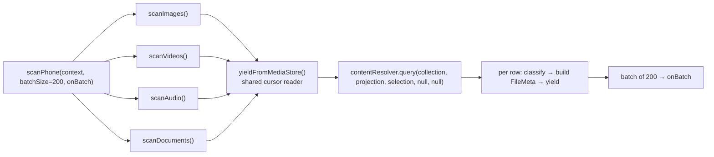

# 05 — Kotlin & the Android Layer

## What the Kotlin layer actually is [VERIFIED-REPO]

Five files, ~1,200 lines, in `modules/vanta-bridge/android/src/main/java/expo/modules/vantaengine/`:

| File | Lines | Role |
|---|---|---|
| `Android_scan.kt` | 486 | MediaStore scanning, `FileType` enum, `FileMeta` data class, extension/MIME classification |
| `VantaEngineModule.kt` | 487 | The Expo module: 20 `AsyncFunction`s, 20 `external fun` JNI declarations, asset extraction |
| `IndexingService.kt` | 129 | Foreground `Service` that owns the long-running indexing thread |
| `VantaEngineConfig.kt` | 56 | Resolves `filesDir/VantaModels`, `filesDir/FaceCrops`, `getDatabasePath("vanta.db")` |
| `MediaLoader.kt` | 24 | `contentResolver.openInputStream(uri).readBytes()` — **written but never called** |
| `VantaEngine.kt` | 0 | empty |
| `VantaInsert.kt` | 2 | a comment saying it's deprecated |

`MediaLoader` being dead is significant — it is the *correct*, scoped-storage-safe way to read a file, and the engine
doesn't use it. See §"The scoped storage problem" below.

---

## Why Kotlin instead of Java?

**Do not say Kotlin is faster.** It isn't. Both compile to JVM bytecode, both run on ART, both are AOT/JIT-compiled
identically. Kotlin can be marginally *slower* in places (boxed nullable types, lambda objects when not inlined) and
marginally faster in others (`inline fun` eliminating lambda allocation). At Vanta's scale the difference is
unmeasurable and is not the reason.

The real reasons, all visible in this code:

| Reason | Where it shows up in Vanta |
|---|---|
| **Null safety across the JNI boundary** | `FileMeta.absPath: String?` and `durationMs: Long?` are *declared* nullable, which forces the C++ side to handle `nullptr` — and `vanta.cpp` does, explicitly, for both. In Java these would be silent `null`s and the JNI code would be written optimistically |
| **Data classes** | `FileMeta` has 14 fields. In Java that's ~120 lines of constructor/getters/equals/hashCode. The JNI layer reads it via `GetFieldID` on the backing fields either way |
| **Sequences / coroutine-free laziness** | `scanImages()` returns `Sequence<FileMeta>` built with `sequence { yield(...) }`, so the MediaStore cursor stays open only while consumed and rows are produced lazily. The Java equivalent is an explicit `Iterator` implementation |
| **Extension functions** | `String.toFileType()`, `String?.isValidMedia()` read as domain vocabulary |
| **Scoped resource management** | `cursor.use { }` is `try-with-resources` without the ceremony; the scan explicitly relies on it |
| **`object` singletons** | `VantaEngineConfig`, `MediaLoader` |
| **It is the Android default** | Since 2019 Google's docs, samples and Jetpack APIs are Kotlin-first. The Expo Modules API's Android side is written in Kotlin (`expo.modules.kotlin.modules.Module`) — using Java would mean fighting the framework |

**Interoperability:** JNI does not care. `Java_expo_modules_vantaengine_VantaEngineModule_startStoring` is the
mangled name for a Kotlin `external fun` exactly as it would be for a Java `native` method, because Kotlin compiles
to a JVM class with the same name. `FindClass("expo/modules/vantaengine/FileMeta")` and
`GetFieldID(cls, "absPath", "Ljava/lang/String;")` work because Kotlin data-class properties become private fields
with those exact names and descriptors.

> One Kotlin-specific JNI detail worth knowing: the `FileType` **enum** is read by calling `.name()` —
> `GetMethodID(fileTypeClass, "name", "()Ljava/lang/String;")`. Kotlin enums are Java enums, so `name()` is
> inherited from `java.lang.Enum`. Vanta then maps `"image"` → `"picture"` in C++ to satisfy the SQLite
> `CHECK(filetype IN ('picture',…))` constraint. That string remap across the boundary is a design smell — the enum
> should simply have been named `picture` — and it's an easy thing for an interviewer to spot in `vanta.cpp`.

---

## MediaStore — how discovery actually works



Four collections are queried:

| Collection | URI | Notes |
|---|---|---|
| Images | `MediaStore.Images.Media.EXTERNAL_CONTENT_URI` | + `WIDTH`, `HEIGHT` |
| Video | `MediaStore.Video.Media.EXTERNAL_CONTENT_URI` | + `DURATION` |
| Audio | `MediaStore.Audio.Media.EXTERNAL_CONTENT_URI` | + `DURATION` |
| Documents | `MediaStore.Files.getContentUri("external")` | No document table exists in Android; the generic Files table is filtered row-by-row. SQL pre-filter: `SIZE > 0 AND MIME_TYPE IS NOT NULL AND MIME_TYPE != ''` |

### Classification: extension first, MIME second

```kotlin
private fun inferFileType(path: String?, mime: String): FileType? =
    path?.toFileType() ?: mimeToFileType[mime]
```

The comment states the reasoning precisely: *"A present path with an unknown extension is not reclassified from MIME.
This avoids accepting files whose declared MIME conflicts with their filename."* Content providers return generic or
wrong MIME types often enough (`application/octet-stream` for a `.heic`) that the extension is the more trustworthy
signal when it exists. The MIME map is the fallback for scoped storage, where `DATA` is null.

Supported: 17 image extensions (including RAW — `.dng`, `.cr3`, `.nef`, `.arw`), 7 video, 11 document, 7 audio.
Note that **OpenCV cannot decode most of those RAW formats or HEIC**, so they will be scanned, inserted as
`filetype='picture'`, fail `cv::imread`, and be marked `failed`. That's an honest gap: the scanner's ambition exceeds
the decoder's capability.

### Scoped storage — the important problem

Android 10 (API 29) introduced scoped storage; Android 11 (API 30) enforced it. `MediaStore.MediaColumns.DATA` (the
absolute filesystem path) is deprecated and may be null or stale. The correct access handle is the **content URI**.

Vanta's Kotlin layer documents this correctly:

> `[absPath]` is optional legacy metadata only; **consumers must not use it to open files** because scoped storage may
> hide it or make it stale. — `Android_scan.kt`

And then the C++ layer does exactly that:

```cpp
// vanta.cpp::startStoring
// Prefer absPath (for OpenCV) over contentUri
jstring jAbsPath = (jstring)env->GetObjectField(fileObj, absPathField);
if (jAbsPath != nullptr) { meta.content_uri = absPathCstr; }   // absPath wins
else { /* fall back to contentUri */ }
```

That value lands in `files.abs_path`, and the engine opens it with `cv::imread(path)` and
`std::ifstream(abs_path, std::ios::binary)`. The React Native layer then renders `file:// + abs_path`.

**So the documented invariant is violated end-to-end**, and this is the single most important Android-platform
question an interviewer can ask. The honest answer:

> "The scanner deliberately records both handles and documents that `absPath` is unsafe. The native engine ignores
> that and uses `absPath`, because OpenCV's `imread`/`imdecode` take a filesystem path and the engine has no
> `ContentResolver`. It works today because the app requests `READ_MEDIA_IMAGES` and on most devices the legacy path
> is still readable for media the app can see — but it is fragile: on a device where `DATA` is null the row falls back
> to a `content://` URI that `cv::imread` cannot open at all, and the file silently fails to index.
>
> The correct fix is already half-written in the repo: `MediaLoader.readBytes(context, contentUri)` returns a
> `ByteArray` from the `ContentResolver`, which is exactly what `cv::imdecode` wants. The engine should take bytes
> across JNI (or a file descriptor from `openFileDescriptor`) rather than a path. `MediaLoader` exists and is never
> called — that's the unfinished half of this design."

### Permissions

The module ships its own `AndroidManifest.xml`, which Gradle's manifest merger folds into the final app manifest.
It is correct and complete for what it declares [VERIFIED-REPO]:

```xml
<uses-permission android:name="android.permission.READ_MEDIA_AUDIO" />
<uses-permission android:name="android.permission.READ_MEDIA_VIDEO" />
<uses-permission android:name="android.permission.READ_MEDIA_IMAGES" />
<uses-permission android:name="android.permission.FOREGROUND_SERVICE" />
<uses-permission android:name="android.permission.FOREGROUND_SERVICE_DATA_SYNC" />
<application>
  <service android:name="expo.modules.vantaengine.IndexingService"
           android:foregroundServiceType="dataSync"
           android:exported="false" />
</application>
```

Three things are right here and worth pointing out: `FOREGROUND_SERVICE_DATA_SYNC` is the API-34 granular permission
that pairs with `android:foregroundServiceType="dataSync"` (so the `startForeground(id, notification, 1)` call in
`IndexingService` is backed by a declared type, and won't throw on 34+), and `exported="false"` correctly prevents
other apps from starting the indexer.

**The gap: there is no `READ_EXTERNAL_STORAGE`.** `READ_MEDIA_IMAGES`/`VIDEO`/`AUDIO` only exist from **API 33
(Android 13)**. The bundled ONNX Runtime `.so` is built for **Android 24 (API 24)**, so the app's `minSdk` is far
below 33. On any device running API 24–32, the app therefore holds **no** storage permission at all and the MediaStore
scan returns zero rows — silently, because `logMediaPermissions` only logs the result and nothing gates the scan on it.

> **Interview answer:** "The permissions are declared for Android 13+, but minSdk is 24, so on Android 12 and below
> there's no granted permission and the scan comes back empty with no error. The fix is the standard pair —
> `READ_EXTERNAL_STORAGE` with `android:maxSdkVersion="32"` alongside the granular ones — plus an actual runtime
> permission request and a hard gate on the scan instead of a log line."

Note also that `logMediaPermissions` only **logs**; nothing in the Kotlin layer ever *requests* a permission or
refuses to scan without one.

---

## The foreground service

```kotlin
class IndexingService : Service() {
    override fun onStartCommand(...): Int {
        startForeground(NOTIFICATION_ID, notification, /* type */ 1)   // API 29+
        indexingThread = Thread {
            extractAssetsIfNeeded(this)
            setModelsDirNative(...); setCropsDirNative(...)
            generateEmbeddingsNative(dbPath)          // blocks for minutes
        }.also { it.start() }
        return START_STICKY
    }
}
```

**Why a foreground service and not `WorkManager` or a plain thread?**

| Option | Problem |
|---|---|
| Plain background thread in the app process | Android freezes/kills backgrounded app processes. Indexing 50k photos takes far longer than the app stays foregrounded |
| `WorkManager` | The *right* long-term answer — it survives reboot, respects Doze, supports constraints (charging, idle, battery-not-low) and retry/backoff policies. But its work is chunked and can be deferred/interrupted; Vanta's indexer is one long blocking JNI call, which fits a foreground service more naturally |
| **Foreground service** ✅ | Shows a persistent notification, gets a much higher OOM-adjustment score, runs while the app is backgrounded |

**Honest limitations of the implementation:**

- `START_STICKY` means Android will restart the service after a kill — **with a null Intent**, so
  `intent?.action == ACTION_START` is false and nothing resumes. Indexing does not actually auto-resume; the user
  must press the button again. (It *is* resumable in the sense that `status='pending'` rows survive, so no work is
  redone — but it isn't automatic.)
- No `Doze`/battery constraints. Indexing will happily run on 5% battery at 40 °C. See
  [17](./17_PERFORMANCE_AND_SCALABILITY.md) for the design fix.
- `startForeground(id, notification, 1)` passes the raw integer `1` as `foregroundServiceType`
  (`FOREGROUND_SERVICE_TYPE_DATA_SYNC`) with a try/catch fallback. On API 34+ this type must also be declared in the
  manifest or the call throws `MissingForegroundServiceTypeException`.
- `IndexingService.extractAssetsIfNeeded` copies **6** files; `VantaEngineModule.extractAssetsIfNeeded` copies **9**
  (it adds `ner_model.onnx`, `ner_vocab.txt`, `label_map.json`). Two divergent copies of the same list. In practice
  the module's `OnCreate` runs first so all 9 land, but it's a latent bug.

---

## Asset extraction: why copy models out of the APK at all?

ONNX Runtime needs a **regular file on disk** to `mmap` a model. APK assets are entries inside a zip; `AAssetManager`
can give you a buffer, and *uncompressed, page-aligned* assets can be mapped — but the reliable, portable approach is
to copy once into `filesDir` on first use. That's what `extractAssetsIfNeeded` does, guarded by `if (file.exists())
continue`.

**Cost:** the models are duplicated — once compressed in the APK, once expanded in `filesDir`. With CLIP FP16 at
roughly 175 MB + 127 MB, that is a substantial amount of user storage consumed twice. The alternative is
`android:extractNativeLibs`-style uncompressed assets + `AAsset_openFileDescriptor` + `Ort::Session` from a memory
buffer (`Ort::Session(env, model_data, model_data_length, options)`), which ORT supports. That's a real, concrete
improvement to propose.
