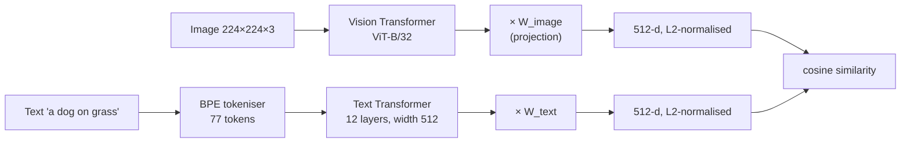

# 09 — CLIP & Image-Text Retrieval

## Part 1 — CLIP from first principles

### The problem CLIP solves

A classifier maps an image to one of *K* fixed labels. You cannot ask it about a concept outside *K*. CLIP
(Radford et al., 2021, *"Learning Transferable Visual Models From Natural Language Supervision"*,
<https://arxiv.org/abs/2103.00020>) replaces the fixed label set with **language itself**: it learns a single vector
space where an image and a sentence describing it land in the same place.

### The architecture



**ViT-B/32 image encoder:** the 224×224 image is cut into non-overlapping **32×32 patches** → (224/32)² = **49
patches**. Each is linearly projected to a 768-d token; a learned `[CLS]` token is prepended (50 tokens) and
positional embeddings added. 12 transformer blocks, 12 heads, width 768. The final `[CLS]` representation is
projected by `W_image` (768→512). **[VERIFIED-EXT]** ~88 M parameters.

**Text encoder:** byte-pair encoding to at most **77** tokens bracketed by `<|startoftext|>` (49406) and
`<|endoftext|>` (49407); a 12-layer, width-512, 8-head causal transformer; the representation at the `[EOT]`
position is projected by `W_text` (512→512). **[VERIFIED-EXT]** ~63 M parameters including the 49408×512 token
embedding.

### Contrastive learning — the actual objective

Take a batch of *N* (image, caption) pairs. Compute all *N* image embeddings and all *N* text embeddings, L2-normalise
both. Form the *N*×*N* matrix of cosine similarities scaled by a learned temperature:

$$ \text{logits}_{ij} = \frac{I_i \cdot T_j}{\|I_i\|\|T_j\|} \cdot e^{\tau} $$

The *N* diagonal entries are the **positive pairs**; the *N*²−*N* off-diagonal entries are **in-batch negatives**.
The loss is symmetric cross-entropy — once treating each row as an *N*-way classification over texts, once treating
each column as an *N*-way classification over images:

$$ \mathcal{L} = \tfrac{1}{2}\Big[\text{CE}(\text{logits}, \text{arange}(N)) + \text{CE}(\text{logits}^\top, \text{arange}(N))\Big] $$

Four consequences to be able to state:

1. **Negatives are free.** You never label a negative; every other caption in the batch is one. This is why CLIP
   scaled to 400 M pairs from the web.
2. **Large batches matter enormously.** The task gets harder (and the gradient more informative) as *N* grows — CLIP
   trained at N = 32,768.
3. **The temperature `τ` is learned, and clipped** (to ≤100 in the original implementation) because the model will
   otherwise drive it to make the softmax arbitrarily peaked.
4. **Only relative geometry is learned.** The space has no absolute meaning — a cosine of 0.31 is not "31% relevant".
   **Scores are only comparable across candidates for the same query**, which is exactly how Vanta uses them (ranking
   within a candidate set), and it's why you can't set a global "relevance threshold."

### Why L2 normalisation matters here

After normalising both vectors to unit length, `cos(a,b) = a·b`. That is why every `float` of every embedding in
Vanta is stored normalised and why ranking is a plain dot product. It also links the two distance metrics:

$$ \|a-b\|_2^2 = 2 - 2(a \cdot b) \quad\Longrightarrow\quad \cos = 1 - \frac{L2^2}{2} $$

**Memorise that identity** — it is how you convert every sqlite-vec L2 distance in this codebase into a cosine
similarity, and it's the basis of every threshold in [11](./11_FACE_CLUSTERING_AND_PERSON_SEGREGATION.md).

---

## Part 2 — Exactly how Vanta uses CLIP

### Model and export [VERIFIED-REPO]

```python
# produce_model/get_onnx_CLIP.py
model, preprocess = clip.load("ViT-B/32", device="cpu")
torch.onnx.export(model.visual, torch.randn(1,3,224,224), "clip_image_encoder.onnx",
                  opset_version=18, input_names=["IMAGE"], output_names=["IMAGE_EMBEDDING"],
                  dynamic_axes={"IMAGE":{0:"batch_size"}, "IMAGE_EMBEDDING":{0:"batch_size"}})

class TextEncoderWrapper(torch.nn.Module):
    def forward(self, text): return self.model.encode_text(text)
torch.onnx.export(TextEncoderWrapper(model), clip.tokenize(["search query"]), "clip_text_encoder.onnx",
                  opset_version=18, input_names=["TEXT"], output_names=["TEXT_EMBEDDING"])
```

Then `convert_tosingle_file.py` (bundles external weight data inline, so there's one file to ship) and
`quantize.py` (`float16.convert_float_to_float16`) → `clip_image_fp16.onnx`, `clip_text_fp16.onnx`.

**A detail worth knowing:** exporting `model.visual` works because OpenAI's `VisionTransformer.forward` applies
`x = x @ self.proj` internally — so `model.visual` already outputs the **512-d shared-space** embedding, not the
768-d backbone feature. Likewise `encode_text` applies `text_projection`. If either projection had been outside the
exported module, the two encoders would live in **different spaces** and every similarity would be noise. Being able
to say why the export is correct is a strong signal.

### Image path

```cpp
// CLIP_image.cpp::load_img
image = cv::imread(img_path);                          // BGR, uint8
cv::resize(image, image, cv::Size(224, 224));          // ← see the bug below
cv::cvtColor(image, image, cv::COLOR_BGR2RGB);         // ✅ correct
image.convertTo(image, CV_32F, 1.0/255.0);             // ✅ [0,1]
cv::split(image, channels);
for (int i=0;i<3;++i) channels[i] = (channels[i] - mean[i]) / std_dev[i];   // ✅ correct constants
// pack into a contiguous NCHW blob via memcpy per channel  ✅
```

The normalisation constants are the correct OpenAI CLIP values:
`mean = (0.48145466, 0.4578275, 0.40821073)`, `std = (0.26862954, 0.26130258, 0.27577711)`. ✅

### 🔴 The preprocessing bug: aspect-ratio distortion

OpenAI's reference `preprocess` for CLIP is:

```python
Compose([Resize(224, interpolation=BICUBIC),   # resize SHORTEST side to 224, preserving aspect ratio
         CenterCrop(224),
         ToTensor(), Normalize(mean, std)])
```

Vanta does `cv::resize(image, image, cv::Size(224,224))` — an **anisotropic squash** to a square, with the default
`INTER_LINEAR` rather than bicubic.

| Photo | Reference (resize-short + center-crop) | Vanta (squash) |
|---|---|---|
| 4:3 landscape (4032×3024) | scale to 298×224, crop centre 224×224 | squashed **1.33× horizontally** |
| 16:9 (1920×1080) | scale to 398×224, crop centre | squashed **1.78× horizontally** — faces become visibly wide |
| 9:16 portrait | scale to 224×398, crop centre | squashed **1.78× vertically** |

This is a **train/inference preprocessing mismatch**: CLIP never saw anisotropically stretched images during
training. The effect is a systematic, silent degradation of every single image embedding in the database.

> **Interview framing:** *"This is the bug I'd fix first, because it's cheap and it affects 100% of the index. The
> trade-off isn't free though — centre-cropping a 16:9 photo throws away 44% of the frame, and in a personal photo
> library the subject isn't always centred. The principled options are (a) match the reference exactly, (b) pad to
> square with the dataset mean and resize isotropically — which keeps the whole frame at the cost of a border CLIP
> never saw, or (c) embed both a centre crop and a full padded view and max-pool the similarity. I'd A/B them,
> but only after building the evaluation harness, because right now I have no way to tell which is better."*

### Text path

```cpp
std::vector<int64_t> tokens = tokenizer->encode(clip_caption);      // BPE, padded to 77
std::vector<float> emb = clip_session->get_text_embedding(tokens);  // ORT, int32 input
// L2-normalise (guarded against norm == 0)
```

`CLIP_tokenizer.cpp` is a hand-written BPE: lowercase, regex split `[a-z0-9]+|[^a-z0-9\s]+`, mark the final character
of each word with `</w>`, then greedily apply the lowest-rank merge from `merges.txt` until no merge applies. Prepend
49406, append 49407, zero-pad to 77.

**Known gaps in the tokeniser** (all real, all fair game):
- **No byte-level unicode mapping.** Real CLIP BPE maps bytes through a 256-entry table so any UTF-8 is
  representable. Vanta splits on raw `char`s, so any non-ASCII input produces multi-byte fragments that miss the
  vocab. Non-English queries silently lose tokens.
- **Unknown tokens are silently dropped** (`if (vocab_.find(bpt) != vocab_.end())` with no `else`) rather than mapped
  to `<|endoftext|>`/UNK.
- **`vocab.json` is parsed with a hand-rolled quote scanner**, not a JSON parser. It works on the well-formed file
  OpenAI ships and would break on anything unusual.
- `tokens.size() >= max_length - 1` compares `size_t` against `int` — signed/unsigned, harmless here because
  `max_length` is a positive constant.

**The interesting asymmetry:** `get_text_embedding` guards `if (norm > 0.0f)` before dividing.
`get_embedding` (image) **does not** — it divides unconditionally. A degenerate all-zero image embedding would
produce 512 NaNs, which would then be written into `clip_vec` and poison every subsequent KNN. Low probability,
trivial fix, good thing to have noticed.

### Storage and search

```sql
CREATE VIRTUAL TABLE clip_vec USING vec0(file_id INTEGER PRIMARY KEY, embedding FLOAT[512]);
-- global KNN path:
SELECT file_id, distance FROM clip_vec WHERE embedding MATCH ? AND k = ?;
-- restricted path: fetch each candidate's blob and dot-product it in C++
```

**A real inconsistency in the result contract:** in the restricted branch `res.distance = 1.0f - cosine`, and in the
global-KNN branch `res.distance = ` sqlite-vec's **L2** distance. Those are different scales
(cosine-distance ∈ [0,2] vs L2 ∈ [0,2] — numerically overlapping but *not equal*: L2² = 2−2cos). So the same field
means two different things depending on which path ran, and the UI cannot compare them. Worth fixing by normalising
both to cosine distance.

---

## Part 3 — Why CLIP (and not something else)

### Why open-vocabulary retrieval is required

Vanta cannot enumerate its label set. These are real target queries:

`beach` · `sunset` · `graduation` · `dog running` · `people in a temple` · `family dinner` · `kedarnath` · `diwali`

A tagger would need every one of these as a class, plus their compositions. CLIP needs none — it embeds the sentence.

**Why manual/generated tags are insufficient:**
- **Vocabulary ceiling.** A 1,000-class tagger has 1,000 concepts. "family dinner" isn't one.
- **No compositionality.** Tags are a set; "dog **on** grass" and "grass **on** dog" have identical tag sets.
- **No graded relevance.** A tag is binary. Ranking 500 beach photos needs a score.
- **User burden.** Manual tagging at 10k–100k photos is not a product.
- **Ironically, you'd still need a model to generate the tags** — at which point you have all the costs of an
  ML pipeline and none of the open-vocabulary benefit.

### Model landscape [VERIFIED-EXT where cited]

| Model | Retrieval quality | Mobile-friendly | Size (params) | Latency | Main advantage | Main limitation |
|---|---|---|---|---|---|---|
| **CLIP ViT-B/32** (Vanta) | Good baseline | Moderate | 151 M total (88 M vis + 63 M txt) | ~150–200 ms/img on mobile CPU **[ESTIMATED]** | Ubiquitous, ONNX-exportable in 20 lines, huge ecosystem | Weakest of the modern options; 32×32 patches lose fine detail |
| **OpenCLIP** (LAION) | Better at equal size; ViT-B/32 trained on LAION-2B beats OpenAI's | Same | Same | Same | **Drop-in identical architecture, better weights, open data.** Free accuracy | None relevant — this is a strict upgrade path |
| **SigLIP / SigLIP 2** (Zhai et al., <https://arxiv.org/abs/2303.15343>) | **Better.** Sigmoid pairwise loss instead of softmax-over-batch | Yes (B/16 variants) | ~200 M (B/16) | Higher (16×16 patches = 196 tokens vs 49) | Loss decouples from batch size; stronger zero-shot & retrieval | Bigger and slower; ViT-B/16 is ~4× the patch tokens of B/32 |
| **MobileCLIP** (Apple, <https://arxiv.org/abs/2311.17049>) | S0 ≈ ViT-B/16 quality at far lower cost | **Designed for this** | S0 ~11 M image encoder | ~5× faster than ViT-B/16 **[VERIFIED-EXT]** | Purpose-built for on-device image-text retrieval | Newer, less battle-tested; needs its own export path |
| **EVA-CLIP** | State of the art at scale | No | 400 M–5 B | Far too slow | Best accuracy | Server-class only |
| **ALIGN** (Google) | Comparable to CLIP | No | ~800 M | — | Noisy-web-scale training | Not openly released |

**Distinguish the model categories** — an interviewer may test this:

| Category | What it produces | Can it do retrieval? |
|---|---|---|
| **Embedding models** (CLIP, SigLIP, MobileCLIP) | one vector per image / per text, shared space | **Yes — this is the only category that indexes** |
| **Classifiers** (ResNet, EfficientNet) | probabilities over fixed classes | No (closed vocabulary) |
| **VLMs / captioners** (BLIP-2, LLaVA, Qwen-VL) | text describing an image | Not directly — you'd caption every photo then do text search. Orders of magnitude more compute per image, and you're searching the caption's lossy summary rather than the image |
| **Generative multimodal LLMs** (GPT-4V-class) | free-form reasoning | Excellent at answering *about* an image; catastrophic as an index (one forward pass per image per query) |

### The three questions you will be asked

**"Why didn't Vanta use SigLIP?"**
> "Mostly pragmatics. SigLIP is a better model — the sigmoid pairwise loss removes the global softmax over the batch,
> so it trains better and it beats CLIP on retrieval at comparable size. But the strong SigLIP checkpoints are
> ViT-B/16, which is 196 patch tokens versus ViT-B/32's 49 — roughly 4× the attention cost per image, on a pipeline
> that already takes hours to index a library. I also had a 20-line `torch.onnx.export` path for OpenAI CLIP and a
> known-good FP16 conversion, and I was one person on a three-week build. **The honest answer is that I optimised for
> a working end-to-end pipeline before optimising the encoder.**"

**"Why didn't Vanta use MobileCLIP?"**
> "This is the one I should have used, and I'd say so. MobileCLIP-S0 was built for exactly this problem — it's
> roughly ViT-B/16-quality retrieval at a fraction of ViT-B/32's inference cost, with an 11 M-parameter image
> encoder against my 88 M. That would cut my per-image indexing cost several-fold and shrink the APK by well over
> 150 MB, which is my actual binding constraint. The reasons I didn't are weak ones: I knew the OpenAI CLIP export
> path, and it was already working."

**"What would you choose today, and why?"**
> "**MobileCLIP-S0 or S1 for the image encoder**, because indexing throughput and model size are my two hard
> constraints and it dominates ViT-B/32 on both. If I had headroom and accuracy mattered more than battery —
> say a desktop companion app — **SigLIP 2 ViT-B/16**. And regardless of which I pick, the *cheapest* upgrade
> available right now is swapping OpenAI's ViT-B/32 weights for **OpenCLIP's LAION-2B ViT-B/32**: identical
> architecture, identical export path, identical latency, strictly better retrieval. That's free accuracy and I'd
> take it first.
>
> But I'd want to be honest about sequencing: **none of these is my top priority.** My aspect-ratio preprocessing bug
> is degrading every embedding I have, and I have no evaluation harness, so today I literally cannot tell whether a
> model swap helped. Fix preprocessing, build Recall@K measurement, *then* change the model."

---

## Part 4 — CLIP's limitations (and which ones bite Vanta)

| Limitation | Why | Bites Vanta? |
|---|---|---|
| **Identity** | CLIP is trained on web alt-text. It learns "a man", not "your father". Celebrity faces work only because they appear captioned by name in the training data | 🔴 **Fundamental** — this is precisely why the whole face pipeline and graph exist |
| **Small objects** | ViT-B/32's 32×32 patches mean a 40-px object occupies ~1 patch. Global pooling dilutes it | 🟠 "the photo with the red umbrella in the background" fails |
| **Counting** | Contrastive training gives almost no numeric supervision. "three people" ≈ "people" | 🟠 Silently ignored |
| **Spatial relations** | "dog **on** the sofa" vs "sofa **on** the dog" — bag-of-concepts behaviour | 🟠 |
| **Compositional reasoning** | The ARO/Winoground line of work shows CLIP models behave largely like bags of concepts on attribute binding: "red car and blue house" vs "blue car and red house" | 🟠 |
| **Negation** | "photos **without** my brother" — there is no vector for "not" | 🔴 Cannot be expressed. **But Vanta can answer this via the graph** (`NOT EXISTS` over `face_detections`) — a great example of why the structured index earns its place |
| **OCR / text in images** | Some capability, unreliable at ViT-B/32 | 🟠 "the screenshot with my ticket number" fails |
| **Blur / low quality** | Out-of-distribution relative to curated web images | 🟠 |
| **Domain shift** | Personal phone photos — badly lit, candid, cluttered — differ from web alt-text imagery | 🟠 Systematic, unmeasured |
| **Temporal** | Single frames only; no video, no "before/after" | 🟢 Not applicable (video isn't indexed) |
| **Fine-grained** | Species, model, brand distinctions are weak at B/32 | 🟢 Rarely queried |

### "Explain precisely why CLIP is not a person-recognition model"

This is the highest-value paragraph in this document. Learn it:

> "Three reasons, and they're about the objective, not the capacity.
>
> **First, the training signal.** CLIP's supervision is image–alt-text pairs from the web. Alt-text says 'a man
> smiling at a party.' It essentially never says 'Aaryan.' So the gradient never pushes the model to separate one
> ordinary person from another — there's nothing in the loss that rewards it.
>
> **Second, the objective actively works against it.** Contrastive learning pulls together things that share a
> caption. Two different men at two different beaches share the caption 'a man at the beach,' so CLIP is explicitly
> trained to make their embeddings *similar*. Identity discrimination is the exact opposite of what the loss
> optimises. ArcFace, by contrast, optimises an angular margin that maximises inter-class separation and intra-class
> compactness **over identities** — it's built to do the thing CLIP is built not to do.
>
> **Third, the geometry is wrong.** CLIP embeds a whole 224×224 scene into one vector dominated by scene-level
> content — location, activity, lighting, composition. A face might be 2% of the pixels. ArcFace embeds an
> **aligned 112×112 crop of just the face**, so 100% of its capacity is spent on identity, with pose and scale
> already normalised away by the 5-point similarity transform.
>
> That's the whole architectural argument for Vanta: **CLIP is a scene model and ArcFace is an identity model, and
> you cannot substitute one for the other.** I need both, indexed separately, and a query planner that knows which
> question each one can answer."
