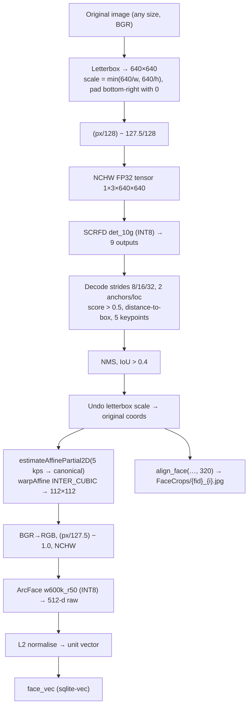

# 10 — Face Recognition

## The five distinct problems (do not conflate these)

| Task | Question | Output | In Vanta |
|---|---|---|---|
| **Detection** | Where are the faces? | bounding boxes + confidence (+ landmarks) | SCRFD-10GF |
| **Alignment** | Normalise pose/scale | 112×112 canonical crop | 5-point similarity transform |
| **Recognition (embedding)** | Represent this face | 512-d unit vector | ArcFace ResNet50 |
| **Verification (1:1)** | Are these two the same person? | boolean, from a threshold on similarity | implicit in clustering |
| **Identification (1:N)** | Which known person is this? | identity or "none" | `person_centroids MATCH k=1` |
| **Clustering (open-set)** | Group unlabelled faces into unknown identities | partition | [11](./11_FACE_CLUSTERING_AND_PERSON_SEGREGATION.md) |

---

## Vanta's exact pipeline



---

## The exact models [VERIFIED-REPO — ONNX graph inspection]

`Seg_model.cpp::load()` resolves **`det_10g.onnx`** and **`w600k_r50.onnx`** — that is **`buffalo_l`**.

> ⚠️ **Every comment in `Seg_model.cpp` says "Buffalo_sc".** The code loads buffalo_l. `buffalo_sc`'s files
> (`det_500m.onnx`, `w600k_mbf.onnx`) *are* committed to the repo but are never referenced by any code path. If an
> interviewer reads that file they will see the contradiction. Own it: *"stale comments from when I prototyped with
> the small pack — the code loads buffalo_l, and here's how you'd verify it."*

### What "buffalo_l" is — do not conflate the bundle with the architecture

**buffalo_l is a model *pack* from InsightFace** (<https://github.com/deepinsight/insightface>), not an architecture.
The full pack ships five models: detection, recognition, genderage, 2d106 landmarks, 3d68 landmarks.

**Vanta uses exactly two of them:**

| Component | File | Architecture | Verified facts |
|---|---|---|---|
| Detector | `det_10g.onnx` | **SCRFD-10GF** (*Sample and Computation Redistribution for Efficient Face Detection*, <https://arxiv.org/abs/2105.04714>) | 4,226,183 params · opset 11 · input `[1,3,?,?]` dynamic · **9 outputs**: `[12800,1] [3200,1] [800,1]` scores, `[12800,4] [3200,4] [800,4]` bbox, `[12800,10] [3200,10] [800,10]` kps · **INT8 dynamic** (48× `DynamicQuantizeLinear`, 58× `ConvInteger`) · 4.11 MB |
| Recogniser | `w600k_r50.onnx` | **ResNet50 trained with the ArcFace loss** on WebFace600K | 43,591,296 params · opset 11 · input `[None,3,112,112]` · output `[1,512]` · **INT8 dynamic** (53× `ConvInteger`, 1× `MatMulInteger`, 25× `PReLU`) · 41.76 MB |

**Never called:** genderage, 2d106, 3d68. Vanta uses only the 5 keypoints the detector already emits.

**The naming decoded** — good detail to have: `w600k` = WebFace600K training set; `r50` = ResNet50 backbone;
`mbf` (in buffalo_sc) = MobileFaceNet; `det_10g` = the detector configuration costing ~10 GFLOPs at 640×640;
`det_500m` = ~500 MFLOPs. So `buffalo_l` is roughly **20× the detection compute** of `buffalo_sc`.

> **"Why buffalo_l and not buffalo_sc?"**
> "Recall on small and non-frontal faces. `det_500m` is ~20× cheaper but misses faces that are small in frame, and in
> a personal photo library most faces are small — group shots, candids, people in the background. A missed detection
> is unrecoverable: that photo can never be found by person. And on the recognition side, ResNet50 embeddings are
> meaningfully more discriminative than MobileFaceNet's, which matters enormously because my clustering has **no
> labels and no human in the loop** — embedding quality is the only thing standing between me and wrong identity
> merges. I paid ~45 MB and roughly 5–10× the per-image cost for that. It is the most expensive decision in the
> indexing pipeline and I'd want to measure whether buffalo_sc plus a better clustering policy beats buffalo_l plus a
> naive one."

---

## Detection: the SCRFD decoder, and the bug in it

### What the hand-written decoder does [VERIFIED-REPO]

```cpp
if (num_anchors == 12800) stride = 8;   // (640/8)²  × 2 anchors = 80·80·2  = 12800 ✅
else if (num_anchors == 3200) stride = 16; // (640/16)² × 2 = 40·40·2 = 3200 ✅
else if (num_anchors == 800)  stride = 32; // (640/32)² × 2 = 20·20·2 = 800  ✅

if (last_dim == 1 || last_dim == 2) score_maps[stride] = {data, last_dim};
else if (last_dim == 4)  bbox_maps[stride] = data;   // distance-to-box: l, t, r, b
else if (last_dim == 10) kps_maps[stride] = data;    // 5 × (dx, dy)
```

Then, per anchor:

```cpp
float cx = col * stride, cy = row * stride;                 // anchor centre
float x1 = cx - bboxes[i*4+0]*stride;                       // distance-to-left
float y1 = cy - bboxes[i*4+1]*stride;
float x2 = cx + bboxes[i*4+2]*stride;
float y2 = cy + bboxes[i*4+3]*stride;
for (pt=0..4) { px = cx + kps[i*10+pt*2+0]*stride;  py = cy + kps[i*10+pt*2+1]*stride; }
```

This is **correct SCRFD decoding** and it's genuinely good work:
- SCRFD is **anchor-free with 2 anchors per location** — both share the same centre, which is why `cx, cy` don't
  change between `k=0` and `k=1` while `anchor_idx` advances. ✅
- Box regression is **distance-based** (FCOS-style: predict distance from the centre to each of the four edges,
  in stride units), not delta-from-anchor-box. ✅
- Keypoints are decoded as offsets from the same centre, same stride scaling. ✅
- `is_logit = (scores[0] < 0.0f || scores[0] > 1.0f)` then conditional sigmoid — a pragmatic guard for exports
  that do or don't bake in the sigmoid. **Fragile**: it decides from a single element. If `scores[0]` happens to be
  a valid probability in a logit-output model, every score is misinterpreted. Better: check for a `Sigmoid` node at
  export time, or test `min/max` over the whole map.
- Conf threshold **0.5**, NMS IoU **0.4** — InsightFace's defaults. ✅

### 🔴 The bug: missing BGR→RGB in the detection path

The function's own comment says:

```
3. NORMALIZATION:
   - Normalize pixel values: (pixel / 128.0) - (127.5 / 128.0)
   - Reorder channels: BGR -> RGB (OpenCV standard conversion)
```

The code does the normalisation and **not** the reorder:

```cpp
padded.convertTo(float_img, CV_32FC3, 1.0f/128.0f, -127.5f/128.0f);   // ✅ matches InsightFace
for (int c = 0; c < 3; ++c)                                           // c indexes BGR, not RGB
  for (int h…) for (int w…)
    input_tensor_values[c*640*640 + h*640 + w] = float_img.at<cv::Vec3f>(h, w)[c];
```

`grep cvtColor Seg_model.cpp` returns **exactly one hit — line 509, inside `get_embedding`** (the recognition path).
The detection path has none, and `cv::imdecode(..., IMREAD_COLOR)` produces **BGR**.

InsightFace's own SCRFD preprocessing is:

```python
blob = cv2.dnn.blobFromImage(img, 1.0/128, input_size, (127.5,127.5,127.5), swapRB=True)
```

`swapRB=True` → the model was trained on **RGB**. Vanta feeds it **BGR**, i.e. the red and blue channels are
transposed on every image.

**Consequences and honest framing:**

> "Detection still works — SCRFD is robust and face detection leans heavily on luminance structure, so swapping R
> and B degrades rather than destroys it. But it is an uncontrolled, systematic domain shift on **every image in the
> index**, and the faces it costs me are exactly the marginal ones: small, dim, side-lit, low-contrast. Those are
> also the faces that most need recall, because a missed detection means that photo is permanently unfindable by
> person. What makes it worse is that the *recognition* path does convert correctly — so the two halves of my own
> face pipeline disagree about colour convention, which tells you it was an oversight rather than a decision.
> One `cv::cvtColor` fixes it, and the right fix is to replace the whole hand-written packing loop with
> `cv::dnn::blobFromImage(..., swapRB=true)`, which does the resize, scale, mean-subtract, channel swap and HWC→NCHW
> in one vectorised pass and removes 1.2 million `at<Vec3f>()` calls per image."

### Other detection-path issues

| Issue | Detail |
|---|---|
| **No minimum face size** | Any box above `score > 0.5` is embedded and clustered, including 12×12-pixel faces upscaled to 112×112. Garbage embeddings enter the cluster space. **The single highest-leverage quality filter Vanta is missing** |
| **Letterbox pads bottom-right only** | `resized.copyTo(padded(cv::Rect(0,0,new_w,new_h)))` — valid (the inverse transform is just `/scale`, no offset), but non-standard; InsightFace also pads to one corner, so this matches |
| **Fixed 640×640** | The model input is dynamic (`[1,3,?,?]`), and the anchor counts are hardcoded to 640. Feeding any other size silently produces `stride == 0` for every output and **zero detections**, with no error |
| **Bounding boxes can fall outside the image** | After `/scale` there is no clamp to `[0,w]×[0,h]`. `align_face` warps from keypoints so it tolerates this, but `bbox_w`/`bbox_h` stored in `face_detections` can exceed the image and are used for avatar selection |

---

## Alignment — this part is textbook-correct

```cpp
const float kTargetLandmarks[5][2] = {
    {38.2946f, 51.6963f},   // left eye
    {73.5318f, 51.5014f},   // right eye
    {56.0252f, 71.7366f},   // nose tip
    {41.5493f, 92.3655f},   // left mouth corner
    {70.7299f, 92.2041f}    // right mouth corner
};
cv::Mat M = cv::estimateAffinePartial2D(src_pts, dst_pts);
cv::warpAffine(image, aligned_face, M, cv::Size(112,112), cv::INTER_CUBIC);
```

These are **exactly** the canonical ArcFace/InsightFace 112×112 reference landmarks. ✅

**Why `estimateAffinePartial2D` and not `estimateAffine2D`?** This is a great question to be asked.

- `estimateAffine2D` fits a full 6-DoF affine: rotation, scale, **translation, shear, and independent x/y scaling**.
- `estimateAffinePartial2D` fits a 4-DoF **similarity** transform: rotation, uniform scale, translation only.

A similarity transform is the right choice because shear and anisotropic scaling would **distort the face geometry**
— and face geometry is precisely the identity signal ArcFace reads. You want to remove pose-induced
rotation/scale/translation while preserving the shape. Using the full affine would let the transform "correct" a
person's actual facial proportions toward the template, erasing identity information. This is a real, principled
decision and the code gets it right.

**Why alignment matters at all:** ArcFace is trained on aligned crops. Feeding an unaligned crop is a train/inference
mismatch as severe as the aspect-ratio bug in [09](./09_CLIP_AND_IMAGE_TEXT_RETRIEVAL.md). Alignment normalises away
in-plane rotation and scale so the embedding can spend its capacity on identity rather than on pose.

**A robustness gap:** `estimateAffinePartial2D` uses RANSAC by default and **returns an empty `cv::Mat` on failure**
(degenerate/collinear keypoints). `cv::warpAffine` with an empty matrix throws. In `run_face_pipeline` the 320-px
avatar crop is wrapped in `try/catch`, but the 112-px call inside `get_embedding` is **not** — that exception
propagates up to the per-image handler in `generateEmbeddingsNative`, which marks the whole file `failed`. So one
bad face can cost you the CLIP indexing of the entire photo. A `if (M.empty()) continue;` guard would fix it.

---

## Recognition: ArcFace

### Preprocessing [VERIFIED-REPO — and correct]

```cpp
cv::cvtColor(aligned_face, rgb_face, cv::COLOR_BGR2RGB);           // ✅
rgb_face.convertTo(float_face, CV_32FC3, 1.0/127.5, -1.0);          // (x − 127.5)/127.5 ∈ [−1,1] ✅
// NCHW pack, then Run, then:
std::vector<float> embedding(raw_output, raw_output + 512);
l2Normalize(embedding);                                             // ✅ (guards norm > 0)
```

This matches InsightFace's ArcFace preprocessing (`input_mean = input_std = 127.5`, `swapRB=True`) exactly. ✅
The raw ONNX output is **not** normalised — Vanta normalising it is required and correct.

### Why ArcFace? The math

Start with ordinary softmax classification over *n* identities:

$$L = -\log \frac{e^{W_{y}^{\top}x + b_{y}}}{\sum_{j} e^{W_{j}^{\top}x + b_{j}}}$$

**The problem:** softmax only needs classes to be *separable*. It produces no guarantee about the *margin* between
them, and nothing forces same-identity embeddings to be tight. Embeddings learned this way transfer badly to
identities the model has never seen — which is Vanta's entire use case.

**ArcFace's transformation** (Deng et al., <https://arxiv.org/abs/1801.07698>):

1. Drop the bias, **L2-normalise both `W_j` and `x`**. Now $W_j^\top x = \cos\theta_j$ — the logit is literally the
   cosine of the angle between the feature and the class prototype. All features live on a **unit hypersphere**.
2. Rescale by a fixed radius *s* (typically 64) so the softmax has usable dynamic range.
3. **Add an angular margin *m* (typically 0.5 rad) to the target class's angle** before the cosine:

$$L = -\log \frac{e^{s\cdot\cos(\theta_{y} + m)}}{e^{s\cdot\cos(\theta_{y} + m)} + \sum_{j \neq y} e^{s\cdot\cos\theta_{j}}}$$

**Why this works — the intuition to say out loud:** because $\cos$ is decreasing on $[0,\pi]$, adding *m* to
$\theta_y$ *lowers* the target logit. To still classify correctly the network must push $\theta_y$ **even smaller**
than it otherwise would — it must overshoot. The result is:

- **intra-class compactness** — samples of one identity cluster tightly around their prototype;
- **inter-class separation** — a guaranteed angular gap of at least *m* between identity regions.

And crucially, the margin is **additive in angle**, so it is *geodesically uniform* on the hypersphere — the margin
means the same thing everywhere on the sphere. That is ArcFace's advantage over CosFace (which subtracts the margin
from the cosine, giving a non-uniform angular margin) and SphereFace (multiplicative angle margin, which is unstable
to train and needs annealing).

**The payoff for Vanta:** a model trained this way produces embeddings whose **cosine similarity is directly
meaningful as an identity score for people the model never saw**. That is exactly the open-set property Vanta needs,
and it's why the entire clustering design reduces to thresholding a dot product.

### Comparison of margin losses

| Loss | Formulation | Note |
|---|---|---|
| **FaceNet / triplet** | anchor–positive–negative, margin in Euclidean distance | Needs hard-negative mining; unstable; slow to converge. Historically first |
| **SphereFace (A-Softmax)** | $\cos(m\theta_y)$ — **multiplicative** angular margin | Needs annealing tricks; non-monotonic |
| **CosFace / AM-Softmax** | $\cos\theta_y - m$ — margin in **cosine** space | Stable and strong; margin is non-uniform in angle |
| **ArcFace** ✅ | $\cos(\theta_y + m)$ — **additive angular** margin | Geodesically uniform margin; the field's default; what Vanta uses |
| **CurricularFace** | margin adapts with training difficulty (easy→hard curriculum) | Better convergence |
| **MagFace** | embedding **magnitude** is trained to encode face quality; margin scales with it | 🟢 **Directly relevant to Vanta** — gives a free quality signal from `‖embedding‖` *before* normalisation |
| **AdaFace** | margin adapts to image quality, estimated from feature norm | 🟢 Also directly relevant; explicitly designed for low-quality faces |
| **MobileFaceNet** | An *architecture*, not a loss (usually trained with ArcFace) | What `buffalo_sc` uses |

> **The forward-looking answer:** *"If I were choosing today for this specific problem, I'd look hard at
> **AdaFace or MagFace**, not because they beat ArcFace on clean benchmarks — they don't by much — but because both
> give me a **quality signal as a byproduct**. MagFace ties the pre-normalisation feature norm to face quality. My
> single biggest weakness is that I cluster every detected face regardless of whether it's a 12-pixel blurry
> profile, and I currently have **no quality estimate at all**. A loss that hands me one for free would let me gate
> clustering on quality without running a second model."*

### Embedding ≠ classification — the open-set argument

| Paradigm | Training | Inference | Can it handle a new person? |
|---|---|---|---|
| **Closed-set classification** | *n* known identities, softmax head | argmax over *n* | ❌ Requires retraining. Impossible here |
| **Verification (1:1)** | metric learning | `cos(a,b) > τ` | ✅ |
| **Identification (1:N)** | metric learning | nearest gallery entry, reject if `< τ` | ✅ |
| **Open-set recognition** | metric learning | identify **or** correctly say "unknown" | ✅ The hard version |
| **Clustering** | metric learning | partition unlabelled embeddings | ✅ **What Vanta does** |

> **"Why does Vanta need an approach that handles identities not known beforehand?"**
> "Because there is no training set and there can't be one. The people in a user's photo library are unknown at build
> time, the app never sees a label, and by design nothing leaves the device so I can't train per-user in the cloud.
> A classifier would need a fixed identity list and retraining every time a new face appears. An ArcFace **embedding**
> converts the problem into geometry: same person ⇒ small angle, different person ⇒ large angle, and that property
> holds for identities the model has never seen — that's exactly what the angular margin bought. So I can discover
> identities by clustering and let the user attach names afterwards. **The model does representation; my code does
> identity.** The cost of that trade is that every identity mistake is now *my* algorithm's fault, not the model's —
> which is precisely where Vanta's real weaknesses live."
