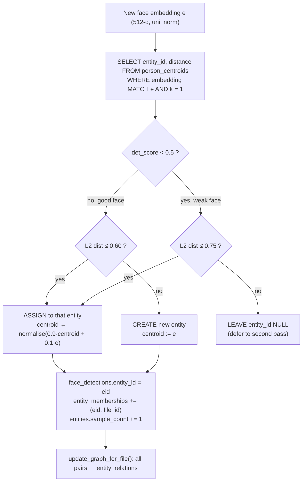
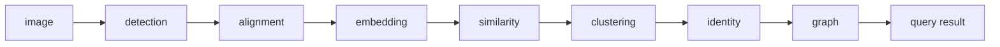

# 11 — Face Clustering & Person Segregation

> This is the weakest and most interesting subsystem in Vanta. It is also where an interviewer who knows the domain
> will spend their time. Know it better than they do.

---

## Part 1 — What Vanta actually implements

### The algorithm: single-pass online nearest-centroid assignment



Then, **after all files are indexed**, two batch passes:

- **Pass 2 — `recluster_pending_faces()`**: every `entity_id IS NULL` detection is re-matched against the now-complete
  centroid set at the relaxed `0.75` threshold. On a match it gets a membership but **deliberately does not update the
  centroid** — the comment says *"We don't update the centroid with poor-quality face embeddings here to avoid
  polluting the centroid."* ✅ That is exactly right thinking.
- **Pass 3 — `merge_similar_entities()`**: greedy pairwise merge of entity centroids, ordered by `sample_count DESC`,
  at L2 ≤ 1.0. Merges the smaller into the larger with a sample-count-weighted centroid average.

### The thresholds, converted [VERIFIED-REPO]

`person_centroids` is `vec0(entity_id INTEGER PRIMARY KEY, embedding FLOAT[512])` with **no `distance_metric`
specified**, so sqlite-vec uses its default, **L2 (Euclidean)**. All embeddings are unit-norm, so
$\cos = 1 - L2^2/2$:

| Constant | Value (L2) | Cosine equivalent | Role |
|---|---|---|---|
| `GOOD_THRESHOLD` | 0.60 | **0.820** | assign a confident face to an existing entity |
| `BLURRY_THRESHOLD` | 0.75 | **0.719** | assign a weak face (`det_score < 0.5`), and the only threshold in pass 2 |
| `BLURRY_DET_SCORE_THRESHOLD` | 0.50 | — | what counts as a "weak" detection |
| `MERGE_THRESHOLD` | 1.00 | **0.500** | merge two entity centroids |

> The source comment on `MERGE_THRESHOLD` says `// L2 distance for centroids (cos_sim >= 0.5)` — the arithmetic is
> correct and shows the author understood the conversion. Good.

---

## Part 2 — What's wrong with it (ranked by severity)

### 🔴 1. The merge threshold is looser than the assignment threshold

This is an **internal inconsistency you can prove without any external benchmark**, which makes it the strongest
critique to lead with:

- For a single face to **join** an existing person, it must reach **cos ≥ 0.82**.
- For two entire **people** to be declared the same person, their centroids need only **cos ≥ 0.50**.

So Vanta's own code asserts that cos 0.55 is *not enough evidence* that one face belongs to a person, while
simultaneously asserting that cos 0.55 *is* enough evidence to fuse two entire identities — an operation that is
**irreversible** and moves every photo of one person onto another.

If the first threshold is right, the second is catastrophically loose. If the second is right, the first is
needlessly strict and is fragmenting every identity. They cannot both be right.

**Why it's especially dangerous:** the merge loop updates `all_entities[i].embedding` in place and keeps scanning `j`,
so merges **chain**. A → B at 0.52, then the blended A′ → C at 0.51, then A″ → D… A single greedy pass with a loose
threshold and an updating centroid can cascade several distinct people into one entity. There is no cluster-purity
check, no size guard, and no undo.

### 🔴 2. Two faces in the same photo can be assigned to the same person

`cluster_faces_for_file` loops over the file's unassigned faces and matches each one **independently**:

```cpp
for (const auto& face : unassigned_faces) {
    // MATCH k=1 against person_centroids ... assign ...
}
```

Nothing prevents face #1 and face #2 in a group photo from both matching entity 7. But a person appears **at most
once in a photograph** — this is a hard, free, always-true constraint, and Vanta ignores it.

This matters more than it sounds. Siblings, parents and children are exactly the people who (a) look most alike and
(b) appear in the same photos most often. So the failure mode is *systematically* concentrated on the family members
the product is built to distinguish. It also corrupts the graph: `update_graph_for_file` uses
`SELECT DISTINCT entity_id`, so a double-assignment collapses two people into one node and the co-occurrence edge
between them is never created.

**The fix is cheap and principled:** within a photo, solve a small assignment problem instead of *k* independent
nearest-neighbour queries. Take the top-*m* candidate entities per face, build a cost matrix, and run
Hungarian/Jonker-Volgenant with a "no entity used twice" constraint. For ≤10 faces this is microseconds.

### 🔴 3. A single centroid is the wrong representation for a person

Covered in depth in Part 3.

### 🟠 4. There is no face quality gate at all

Every detection with `det_score > 0.5` is embedded and clustered. No minimum face size, no blur measure, no pose
estimate, no landmark-quality check. A 14×14-pixel motion-blurred profile is upscaled to 112×112 and treated as
equal evidence to a sharp frontal portrait — and worse, under the current logic a *high*-`det_score` tiny face takes
the **strict** path and can **found a brand-new entity** from one bad embedding.

Note the asymmetry Vanta does get right: `det_score` is used as a *proxy* for quality when picking a threshold. But
`det_score` measures "how confident am I that this is a face", **not** "how good is this face for recognition." A
crisp 20-pixel face scores high; a slightly soft 400-pixel frontal portrait may score lower. It is the wrong signal.

### 🟠 5. The "centroid" is not a centroid

```cpp
new_centroid[i] = old_centroid[i]*0.9f + face.embedding[i]*0.1f;   // then re-L2-normalise
```

`Reads/04` documents the update as the running mean $C_{new} = (C_{old}\cdot n + e)/(n+1)$ and presents EMA as the
"alternative". The code implements the **alternative** — a normalised exponential moving average with α = 0.1.

Consequences, all real:
- **Order dependence.** The final representation depends on the order photos were indexed. Re-index in a different
  order, get a different identity.
- **Recency bias.** After ~30 assignments the earliest faces contribute $0.9^{30} \approx 4\%$. A person's
  representation drifts toward their most recently indexed appearances — which, since MediaStore is scanned in
  collection order, is effectively arbitrary rather than "most recent in time".
- **`sample_count` is meaningless as a weight.** It's incremented on every assignment but never used in the online
  update (only in the merge), so a 500-photo identity and a 3-photo identity adapt at exactly the same rate.

**But:** EMA is not automatically worse than the true mean. It adapts to genuine appearance change (a child growing,
someone shaving a beard), which a lifetime mean resists. The honest position: *"EMA was a reasonable instinct for
appearance drift, but I implemented it without the guard rails EMA needs — no quality weighting, no bound on drift
from the founding exemplar, and a docs/code mismatch that says I wasn't deliberate about it."*

### 🟠 6. A new identity is founded by exactly one embedding

`INSERT INTO person_centroids (entity_id, embedding) VALUES (?, e)` — the very first face becomes the entire identity
prototype. If that face is unusual (extreme pose, harsh light, partial occlusion), the cluster is anchored in the
wrong place and every subsequent good face of that person fails the 0.82 test, founding *another* entity.
This is the primary mechanism behind identity fragmentation, and it's why `merge_similar_entities` exists at all —
the merge pass is a patch for a weakness in the assignment policy.

### 🟠 7. No second-nearest-neighbour (ratio) test

`MATCH ... AND k = 1` retrieves only the single nearest centroid. Classic open-set practice is a **ratio test**:
accept only if `d₁ / d₂ < ρ` — i.e. the best match must be decisively better than the runner-up. When two siblings'
centroids are both at cos ≈ 0.83, Vanta confidently picks whichever is marginally closer. Retrieving `k = 3` costs
essentially nothing (the table has hundreds of rows) and would let Vanta *decline* to decide.

### 🟢 8. Mechanical bugs (verified, see [01](./01_VANTA_REALITY_CHECK.md))

- `entity_memberships.score` is never written → always 1.0 → people-only ranking is unordered.
- The `entity_id = -1` tombstone is rejected by a foreign key → pass 2 re-does the same failed work forever.
- The merge pass cascades away `entity_relations` / `entity_relation_files` instead of transferring them.
- `merge_similar_entities` is **O(n²)** over all entities with a full 512-d L2 per pair, and it re-prepares a fresh
  SQL statement inside the inner loop for each of the 7 statements it runs per merge.

---

## Part 3 — The centroid problem

### Why one vector per person is structurally wrong

A person's face embeddings do **not** form a single isotropic Gaussian blob. They form a **multi-modal
distribution** driven by factors that each shift the embedding systematically:

| Factor | Effect on the embedding |
|---|---|
| **Pose** | Frontal vs 45° profile vs full profile are the dominant axis of variation — often larger than between-person variation |
| **Age** | A face at 5, 15 and 35 are genuinely different modes. In a family photo library spanning years, this is severe |
| **Glasses / facial hair / hairstyle** | Discrete, persistent appearance states → separate modes |
| **Illumination** | Harsh sun, indoor tungsten, night flash |
| **Expression** | Neutral vs laughing vs shouting |
| **Occlusion** | Masks, hands, hair |
| **Capture domain** | Phone camera vs DSLR vs scanned print vs screenshot-of-a-photo |

Now consider what a mean does to a bimodal distribution:

```
     mode A (frontal)                              mode B (profile)
          ●●●●●                                        ●●●●●
        ●●●●●●●●●                                    ●●●●●●●●●
          ●●●●●                                        ●●●●●
                         ✕ centroid
                  (in the empty space between,
                   close to NEITHER mode)
```

The centroid lands in a region **where no actual face of that person lives**. Concretely:

- **Recall collapses.** A new frontal face is close to mode A but far from the centroid → fails the 0.82 threshold →
  founds a spurious new identity. The person fragments.
- **Precision collapses too.** The between-modes region is also where *other people's* embeddings sit. A stranger
  can be closer to the centroid than to any real face of that person → false merge.

So a single centroid is simultaneously **too far from the right faces and too close to the wrong ones.** That is the
crux, and it's worth being able to draw.

Add the specific pathologies of Vanta's version:

| Pathology | Mechanism |
|---|---|
| **Centroid drift** | Normalised EMA with α = 0.1 and no anchor. 30 profile shots in a row can walk the prototype off the frontal mode entirely |
| **Outlier capture** | One badly-aligned or misdetected face (a face in a poster, a reflection) is admitted at full weight and permanently shifts the prototype |
| **Cluster overlap** | Family members' centroids sit close; with `k=1` and no ratio test, assignment between them is near-coin-flip |
| **Cold start** | Founded from a single sample; see §2.6 |

### Better representations, ranked for mobile feasibility

| Representation | How it works | Pros | Cons | Feasible on device? |
|---|---|---|---|---|
| **Single centroid** (today) | 1 vector | Trivial; O(1) storage; one KNN probe | Everything above | ✅ |
| **Medoid** | The actual embedding closest to the mean | Always a *real* face; immune to landing in empty space | Still unimodal | ✅ trivially |
| **Quality-weighted centroid** | $C = \frac{\sum q_i e_i}{\|\sum q_i e_i\|}$ | Cheap; directly suppresses the outlier-capture failure | Still unimodal | ✅ **Best effort/reward ratio** |
| **Multiple exemplars (gallery)** | Keep *k* ≈ 3–10 diverse embeddings; score = **max** similarity over the set | Handles multi-modality directly; naturally interpretable; matches how Apple describes canonical exemplars | *k*× storage and *k*× KNN probes; needs a diversity-selection policy | ✅ **The right target.** 10 × 512 × 4 B = 20 KB per person |
| **Sub-clusters** | Cluster within an identity (e.g. frontal / profile / with-glasses); one centroid per sub-cluster | Explicit modes; can label them | Needs a second clustering level and a split criterion | ✅ with care |
| **Prototype set + covariance** | Mahalanobis distance per identity | Statistically principled | 512×512 covariance = 1 MB per person. Needs many samples | ❌ Not at this dimensionality |
| **Learned per-user head** | Fine-tune a small head on user-confirmed labels | Best possible accuracy | On-device training, catastrophic forgetting, needs labels | ❌ Out of scope |

**The exemplar-gallery design, concretely:**

```cpp
// Scoring: a face belongs to an identity if it's close to ANY exemplar, not to their average
float score(const Face& f, const Identity& id) {
    float best = -1.0f;
    for (const auto& ex : id.exemplars) best = std::max(best, dot(f.emb, ex.emb));
    return best;
}

// Admission: keep the gallery small AND diverse
void maybe_add_exemplar(Identity& id, const Face& f) {
    if (f.quality < Q_MIN) return;                       // never admit junk
    float max_sim = score(f, id);
    if (max_sim > 0.95f) return;                         // redundant with an existing exemplar
    if (id.exemplars.size() < K_MAX) { id.exemplars.push_back(f); return; }
    // Replace the exemplar that contributes least: lowest quality among the most redundant pair
    auto victim = argmin_over(id.exemplars, [&](const Ex& e){ return e.quality - redundancy(e, id); });
    if (f.quality > victim->quality) *victim = f;
}
```

In SQLite this is a **schema change, not an architecture change** — `person_centroids(entity_id PK, …)` becomes
`person_exemplars(exemplar_id PK, entity_id, quality)` in a `vec0` table, and the `k=1` probe becomes `k=5` followed
by a group-by-entity max. That is genuinely a weekend of work and it addresses the single biggest quality problem in
the system.

---

## Part 4 — Face quality

Vanta has **no** quality estimation. Here is the design to propose.

### A composite score, all components cheap and local

$$Q = w_1 s_{\text{size}} + w_2 s_{\text{sharp}} + w_3 s_{\text{pose}} + w_4 s_{\text{det}} + w_5 s_{\text{expo}}$$

| Component | Computation | Cost |
|---|---|---|
| **Size** $s_{size}$ | $\min(1, \frac{\min(w,h)}{112})$ — a face smaller than the model's input is pure upsampling | free (bbox is already stored) |
| **Sharpness** $s_{sharp}$ | Variance of the Laplacian on the 112×112 aligned crop, squashed: $\tanh(\sigma^2_{\nabla^2}/\lambda)$ | one `cv::Laplacian` on a 112×112 crop — negligible |
| **Pose** $s_{pose}$ | From the 5 landmarks Vanta **already has**: yaw ≈ horizontal asymmetry of the nose between the eye midpoints; roll = angle of the inter-ocular line. Or simply: $\|M\|$ residual from `estimateAffinePartial2D` — a large residual means the face doesn't fit the frontal template | free |
| **Detector confidence** $s_{det}$ | `det_score` (already stored) | free |
| **Exposure** $s_{expo}$ | fraction of crop pixels in [10, 245]; penalise clipping | free |
| *(optional)* **Embedding magnitude** | If you switch to **MagFace/AdaFace**, the pre-normalisation $\|e\|$ *is* a learned quality score | free, but requires a different recogniser |
| *(optional)* **Occlusion** | Needs a dense landmark model (`2d106` is already in the buffalo_l pack!) | +1 small model |

A concrete starting point — and be honest that the weights are unvalidated:
$$Q = 0.30\,s_{\text{size}} + 0.30\,s_{\text{sharp}} + 0.20\,s_{\text{pose}} + 0.10\,s_{\text{det}} + 0.10\,s_{\text{expo}}$$

### How quality should change every downstream decision

| Decision | Today | With quality |
|---|---|---|
| **Enter the pipeline at all** | every detection | drop `Q < 0.2` — don't embed it, don't store it |
| **Found a new identity** | any face with `det_score ≥ 0.5` | **only `Q ≥ 0.7`.** A new person must be *established* by a good face |
| **Join an existing identity** | threshold switched on `det_score` | make the threshold a continuous function: $\tau(Q) = \tau_{strict} + (1-Q)\cdot\Delta$. High quality ⇒ strict (you have the evidence to be strict); low quality ⇒ either relaxed, or refuse to decide |
| **Update the representation** | every assignment, α = 0.1 flat | weight by quality: $\alpha_i = \alpha_0 \cdot Q_i$. A blurry face barely moves the prototype |
| **Exemplar admission** | n/a | quality is the primary admission and eviction criterion |
| **Avatar selection** | `det_score > 0.65 AND bbox > 60px`, then `ORDER BY area DESC` — area is a poor proxy | `ORDER BY Q DESC` |
| **Search confidence** | `score` is hardcoded 1.0 | propagate $Q$ into `entity_memberships.score`, which **finally makes the min-score ranking in `get_combined_membership_scores` do something** |

That last row is the neat part: **quality scoring and the dead `score` column are the same fix.** One change repairs
a documented-but-absent ranking feature and gives every other decision a principled input.

---

## Part 5 — The emerging / new-person problem

> *Person X has never been seen. Then 30 photos of X arrive. How do you decide: new person? same person across those
> 30? existing identity? when to merge, split, or leave unknown?*

### What Vanta does today

Photo 1: `MATCH k=1` → nearest centroid at cos 0.4 → below 0.82 → **create entity**, centroid := that one embedding.
Photos 2–30: each matched against that centroid. Those within 0.82 join and EMA-drag the centroid; those outside
(different pose, different lighting) found **more** new entities. At the end, `merge_similar_entities` tries to sew
the fragments back together at the far looser cos 0.50 — and may over-merge in the process.

**The result is a fragment-then-over-merge cycle**, and neither phase has any notion of confidence.

### A better policy

```
PHASE 1 — GATE
    Q = quality(face);  if Q < Q_MIN: mark 'unusable', never cluster it.

PHASE 2 — TRY TO IDENTIFY (conservative)
    cands = knn(exemplars, e, k=5) grouped by entity, score = max sim per entity
    d1, d2 = best and second-best entity scores
    if d1 >= tau_high(Q) and (d1 - d2) >= margin:        ASSIGN (confident)
    elif d1 >= tau_low(Q):                                ASSIGN as 'tentative' (revisitable)
    else:                                                 → PHASE 3

PHASE 3 — DEFER, DO NOT DECIDE
    Put the face in an 'unassigned' pool. Do NOT create an identity from one face.

PHASE 4 — BATCH FORMATION (when the pool has enough, or at end of indexing)
    Run agglomerative clustering with AVERAGE linkage over the unassigned pool.
    Create a new identity only if a cluster has >= N_MIN (e.g. 3) members
      AND intra-cluster cohesion >= C_MIN.
    Everything else stays 'unknown' — which is a valid, honest final state.

PHASE 5 — CONSOLIDATE (conservative, evidence-based)
    Merge two identities only if BOTH:
      (a) cross-identity linkage (min or average, NOT centroid-to-centroid) exceeds tau_merge, AND
      (b) tau_merge is STRICTER than the assignment threshold, AND
      (c) they never co-occur in the same photo   ← free, decisive negative evidence
    Log every merge so it is reversible.

PHASE 6 — USER FEEDBACK
    A confirm/reject is worth more than any number of algorithmic decisions.
    Store it as a must-link / cannot-link constraint and respect it permanently.
```

**Two ideas in there are worth calling out explicitly in an interview:**

1. **"Don't create an identity from one face."** A single embedding is not evidence of a person; it's evidence of a
   detection. Requiring *N* ≥ 3 mutually-consistent faces before minting an identity eliminates most spurious
   entities at a stroke.
2. **Co-occurrence is free negative evidence.** If entity A and entity B appear in the same photograph, they are
   **definitely different people**. Vanta already computes and stores exactly this in `entity_relations` — and then
   never uses it as a constraint. Feeding the graph back into clustering as a hard **cannot-link** is close to free
   and is the most elegant improvement available in this codebase, because it makes the graph layer do double duty.

### Why a fixed global threshold is insufficient

| Reason | Explanation |
|---|---|
| **Quality varies** | The right threshold for a 400-px frontal portrait is not the right threshold for a 40-px profile. Vanta half-acknowledges this with its `det_score` branch, but it's a 2-level step function on the wrong signal |
| **Identities vary** | Distinctive-looking people tolerate a loose threshold; a person with an identical twin in the library needs a strict one. The correct threshold is *per-identity*, calibrated from that identity's own intra-cluster similarity distribution |
| **Library composition varies** | 5 people vs 500 people. With 500 identities the chance that *some* wrong centroid is within 0.82 grows — this is the **multiple-comparisons problem** and it means the threshold should tighten as the gallery grows |
| **Demographics and domain shift** | Published FRVT-style evaluations consistently find that a single global threshold produces **different false-match rates across demographic groups**. A fixed threshold is therefore not just suboptimal, it is unfair — see [19](./19_PRIVACY_SECURITY_FAIRNESS.md) |
| **Symmetric costs are wrong** | A false *merge* (two people become one) is visible, alarming and hard to undo. A false *split* (one person becomes two) is mildly annoying and trivially fixed by the user tapping "same person". **The costs are asymmetric, so the thresholds should be too** — and Vanta has them backwards (§Part 2.1) |

**Calibration without labels** — the practical on-device answer:

> "I can't calibrate against a labelled set, but I can calibrate against the library's own statistics. For each
> identity I have its members' pairwise similarities — that gives me an empirical intra-class distribution. And
> **co-occurring faces give me a free inter-class sample**: two faces in the same photo are known-different people, so
> their similarity is a genuine impostor score. With those two distributions I can pick a threshold at a target
> false-match rate per identity, and re-estimate it as the library grows. That's a real, label-free, on-device
> calibration procedure, and the data for it is already in my database."

---

## Part 6 — How errors propagate



| Stage | Failure | Propagates as | Recoverable? |
|---|---|---|---|
| **Image** | blur, tiny face, harsh light, occlusion, profile | poor-quality signal enters everything downstream | only by filtering (which Vanta doesn't do) |
| **Detection** | **miss** | The photo has no face row at all → **can never be retrieved by person** | ❌ **Silent and permanent.** The worst failure in the system, because nothing reports it |
| **Detection** | **false positive** (poster, reflection, face on a T-shirt) | A phantom identity, or pollution of a real one | 🟠 quality gating would catch most |
| **Alignment** | landmark error, RANSAC failure | Wrong crop → wrong embedding, or a thrown exception that fails the whole file | ❌ no validation exists |
| **Embedding** | INT8 quantisation noise, OOD input | small angular perturbation — usually harmless, occasionally decisive near a threshold | ❌ unmeasured |
| **Similarity** | none of its own | — | — |
| **Clustering** | **false split** | One person becomes N entities. Searching "mom" returns 1/N of her photos | ✅ merge pass, or the user |
| **Clustering** | **false merge** | Two people become one. Searching "mom" returns photos of your aunt | 🔴 **Nearly unrecoverable** — there is no split UI and no provenance log of what was merged |
| **Clustering** | same-photo double assignment | Two people collapse to one node; their co-occurrence edge is never created | 🔴 corrupts the graph silently |
| **Identity** | user names the wrong cluster | Every future query for that name is wrong | ✅ rename |
| **Graph** | missing/destroyed edge | Two-entity fast path misses → falls back to intersection (slower, still correct) | 🟢 degrades gracefully |
| **Query** | — | wrong or missing photos, **with no confidence signal shown to the user** | — |

**The asymmetry to state clearly:** a missed detection and a false merge are the two failures that are both *severe*
and *invisible*. Everything else either self-corrects or is visible enough that a user can fix it. That is why
quality gating (which prevents bad faces entering) and conservative merging (which prevents irreversible damage) are
the two highest-value changes — not a better model.
