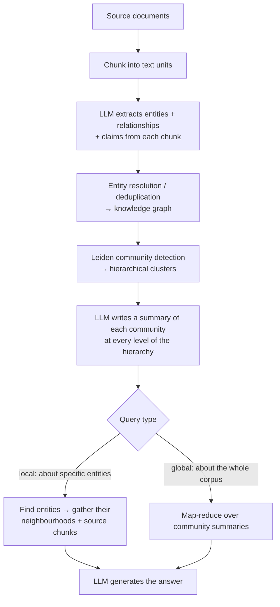

# 13 — The Graph Layer & GraphRAG Inspiration

## Part 1 — Why Vanta has a graph at all

A vector index answers *"what looks like this?"*. It cannot answer *"which files contain **both** of these two
specific people?"* — that is a **conjunctive set-membership query**, and it has three properties that make it
fundamentally unsuited to nearest-neighbour search:

1. **It is exact, not graded.** A photo either contains your mother or it doesn't.
2. **It is conjunctive.** Two constraints must hold simultaneously. There is no single vector whose neighbourhood is
   "photos containing entity 7 AND entity 12" — you would need a separate vector per *combination*, i.e. a
   combinatorial index.
3. **It supports negation.** "Photos without my brother" is a set difference. No embedding represents "not".

So Vanta maintains a second index — a small **property graph implemented in relational tables**.

---

## Part 2 — The graph as implemented [VERIFIED-REPO]

### Nodes

| Node type | Table | Key fields |
|---|---|---|
| **Person entity** | `entities` | `entity_id`, `entity_type` (only `'person'`), `display_name`, `relation`, `age`, `location`, `confidence`, `sample_count` |
| **File** | `files` | `id`, `abs_path`, `filetype`, `mtime_unix`, `face_count`, `status` |

`relation`, `age`, `location` are added by an **idempotent runtime migration** in `graph_db.cpp::init_graph_schema`
that checks `PRAGMA table_info` before each `ALTER TABLE`. That's a genuinely nice touch — schema evolution without
a migration framework.

### Edges

```sql
-- Person ──appears in──► File     (bipartite membership)
CREATE TABLE entity_memberships (
    entity_id INTEGER NOT NULL, file_id INTEGER NOT NULL,
    score REAL DEFAULT 1.0,            -- ⚠️ NEVER WRITTEN. Always 1.0. See 01 §A1
    created_at INTEGER NOT NULL,
    PRIMARY KEY (entity_id, file_id),
    FOREIGN KEY (entity_id) REFERENCES entities(entity_id) ON DELETE CASCADE,
    FOREIGN KEY (file_id)   REFERENCES files(id)           ON DELETE CASCADE);

-- Person ◄──co-occurs with──► Person   (weighted, undirected, canonicalised)
CREATE TABLE entity_relations (
    entity_a INTEGER NOT NULL, entity_b INTEGER NOT NULL,
    co_occurrence_count INTEGER NOT NULL DEFAULT 1,
    first_seen_at INTEGER NOT NULL, last_seen_at INTEGER NOT NULL,
    PRIMARY KEY (entity_a, entity_b),
    CHECK (entity_a < entity_b),       -- ✅ canonical ordering: one row per unordered pair
    FOREIGN KEY (entity_a) REFERENCES entities(entity_id) ON DELETE CASCADE,
    FOREIGN KEY (entity_b) REFERENCES entities(entity_id) ON DELETE CASCADE);

-- The materialised edge→file index that makes 2-person queries O(1)
CREATE TABLE entity_relation_files (
    entity_a INTEGER NOT NULL, entity_b INTEGER NOT NULL, file_id INTEGER NOT NULL,
    PRIMARY KEY (entity_a, entity_b, file_id),
    FOREIGN KEY (entity_a, entity_b) REFERENCES entity_relations(entity_a, entity_b) ON DELETE CASCADE,
    FOREIGN KEY (file_id) REFERENCES files(id) ON DELETE CASCADE);

CREATE INDEX idx_er_a ON entity_relations(entity_a);
CREATE INDEX idx_er_b ON entity_relations(entity_b);
CREATE INDEX idx_erf_file ON entity_relation_files(file_id);
CREATE INDEX idx_erf_pair ON entity_relation_files(entity_a, entity_b);
```

### The `CHECK (entity_a < entity_b)` constraint — a good design detail

An undirected edge stored naively creates two rows (7,12) and (12,7), or requires `OR` in every query. Canonicalising
so the smaller id is always first means **one row per pair**, the primary key does the deduplication, and lookups are
a single equality probe. `update_graph_for_file` enforces it with `std::min`/`std::max`. The cost is that
`get_neighbors` needs `WHERE entity_a = ? OR entity_b = ?` with a `CASE` to pick the other end — which it does
correctly. This is a standard, correct trade and worth being able to explain.

### Edge construction

```cpp
// graph_db.cpp::update_graph_for_file — runs after clustering each file
SELECT DISTINCT entity_id FROM face_detections WHERE file_id = ? AND entity_id IS NOT NULL
if (entities.size() < 2) return true;                 // no pairs, nothing to do
BEGIN;
for (i) for (j > i) {
    a = min(e_i, e_j); b = max(e_i, e_j);
    INSERT INTO entity_relations (…) VALUES (a,b,1,now,now)
      ON CONFLICT(entity_a, entity_b) DO UPDATE
      SET co_occurrence_count = co_occurrence_count + 1, last_seen_at = excluded.last_seen_at;
    INSERT OR IGNORE INTO entity_relation_files VALUES (a,b,file_id);
}
COMMIT;
```

It is **O(k²)** in the number of distinct people per photo — fine, since *k* is single digits. The upsert is a proper
SQLite `ON CONFLICT ... DO UPDATE`, and the whole per-file update is transactional with rollback on failure. ✅

> ⚠️ Note the `SELECT DISTINCT`: if the clustering double-assigns two faces in one photo to the same entity
> (see [11 §Part 2.2](./11_FACE_CLUSTERING_AND_PERSON_SEGREGATION.md)), `DISTINCT` collapses them and the edge
> between those two real people is **never created**. A clustering bug silently becomes a graph gap.

### How the graph is actually queried

| Query shape | SQL path | Complexity |
|---|---|---|
| **1 entity** | `SELECT file_id FROM entity_memberships WHERE entity_id = ?` | index scan |
| **2 entities** | `SELECT file_id FROM entity_relation_files WHERE entity_a = ? AND entity_b = ?` | **O(1) PK probe — the materialised edge earns its keep** |
| **3+ entities** | fetch each entity's membership set, find the **smallest**, probe the rest against it | O(min set size × k) |
| **Empty intersection** | ⚠️ silently falls back to **UNION** with `require_all = false` | relaxes the correctness guarantee |
| **Neighbours (People UI)** | `entity_relations` ordered by `co_occurrence_count DESC` | the only place `co_occurrence_count` is read |

**Traversal depth: 1 hop.** There is no BFS, no path-finding, no transitive traversal. The "graph" is used as a
**materialised co-occurrence index**, not as something you walk. That is an important honesty point — see Part 4.

---

## Part 3 — GraphRAG: inspiration vs. implementation

> ⚠️ **The single most important sentence in this document:**
> **Vanta does not implement GraphRAG. It borrows two ideas from it. Say this before anyone asks.**

### What GraphRAG is

**GraphRAG** (Microsoft Research, *"From Local to Global: A Graph RAG Approach to Query-Focused Summarization"*,
<https://arxiv.org/abs/2404.16130>; <https://github.com/microsoft/graphrag>) is a retrieval-augmented-generation
pipeline that builds an **LLM-derived knowledge graph** over a text corpus and uses it to answer questions that
plain vector RAG cannot.

Its pipeline:



### What problem GraphRAG attempts to solve

Plain vector RAG retrieves the top-*k* chunks most similar to the query and stuffs them into an LLM's context. It
fails on two kinds of question:

1. **Multi-hop / entity-centric.** *"How is Alice connected to the Berlin project?"* The answer may require chunk A
   (Alice → team X) and chunk C (team X → Berlin). Neither chunk is individually similar to the query, so top-*k*
   retrieval never surfaces both. **Similarity is not transitive; relationships are.**
2. **Global / sensemaking.** *"What are the main themes in this corpus?"* No individual chunk contains the answer —
   it is a property of the whole. Community summaries give you a place to retrieve *from*.

### Why graph structure helps

Because a graph makes **relationships first-class and traversable**. In a vector index, "related to" is only ever
"nearby in embedding space", which is a single, symmetric, untyped, non-transitive relation. In a graph you can have
typed edges, walk them transitively, and reach a node that is *structurally* relevant while being *semantically*
dissimilar to the query.

### Which GraphRAG ideas influenced Vanta

| GraphRAG idea | How it shows up in Vanta |
|---|---|
| **Extract entities from unstructured input, then resolve them to canonical graph nodes** | ✅ This is the core borrowing. GraphRAG uses an LLM over documents; Vanta uses **BERT-tiny NER over the query** and **ArcFace clustering over the images**. Same shape: unstructured input → entity mentions → resolved canonical entity IDs |
| **Structure-then-semantics: use the graph to select candidates, then use similarity within them** | ✅ Exactly Vanta's `graph filter → CLIP rerank` ordering |
| **Relationships are first-class data, not an emergent property of an embedding space** | ✅ `entity_relations` with an explicit weighted co-occurrence edge |
| **A query is a *plan*, not a lookup** — decide which index can answer which part | ✅ Vanta's query engine decomposes the sentence into an entity part and a visual part and routes each separately |

### Which GraphRAG ideas are NOT in Vanta

| GraphRAG component | In Vanta? | Why not |
|---|---|---|
| **LLM-based extraction** | ❌ | No LLM on device. BERT-tiny tags the *query*; nothing extracts from the *content* |
| **Multi-hop traversal** | ❌ | Strictly 1 hop. `get_neighbors` exists but only feeds the People UI, never the ranker |
| **Community detection (Leiden)** | ❌ | Would be genuinely useful — see Part 4 |
| **Hierarchical community summaries** | ❌ | Requires an LLM to write summaries |
| **Global / map-reduce query mode** | ❌ | Vanta answers only local, entity-specific queries |
| **Generation** | ❌ | **Vanta has no G in its RAG.** It returns ranked photos, not generated text |
| **Claims / covariates** | ❌ | — |
| **Typed relationships** | ❌ | One edge type: co-occurrence. No "parent of", "friend of" as *edges* (relation is an attribute on the node, not an edge) |

### The comparison table

| GraphRAG concept | Vanta equivalent | Difference |
|---|---|---|
| Documents / text units | Image files | Vanta's units are non-textual; there is no chunking |
| LLM entity extraction from content | **Face detection + ArcFace + clustering** | The "entities" are discovered by a vision pipeline, not a language model. Unsupervised, so entity *quality* is Vanta's weak point where GraphRAG's is *cost* |
| Entity resolution / dedup | `resolve_span_to_entity_id` (Damerau-Levenshtein ≤ 2) + `merge_similar_entities` (centroid L2 ≤ 1.0) | Vanta resolves at two different places with two different mechanisms — string-level at query time, vector-level at index time |
| Knowledge graph | `entities` + `entity_memberships` + `entity_relations` | One node type, one edge type. GraphRAG has rich typed schemas |
| Community detection + summaries | **absent** | The biggest structural gap |
| Local search | graph candidate selection | Vanta's is 1-hop and exact; GraphRAG's expands the neighbourhood and pulls source text |
| Global search | **absent** | No corpus-level questions |
| Vector similarity on chunks | CLIP similarity on images | Same role: the graded relevance signal |
| LLM generation | **absent** | Vanta ranks and returns; it never synthesises |
| Query decomposition | NER → spans → entity IDs + residual text | Conceptually the same move, done with a 4 M-param tagger rather than an LLM |

### How Vanta adapts the ideas to an offline mobile photo-search setting

| GraphRAG assumption | Vanta's constraint | The adaptation |
|---|---|---|
| An LLM is available and calls are affordable | No LLM; a strict CPU/battery budget | Replace LLM extraction with a **4 M-param tagger on the query** and an unsupervised **vision pipeline on the content** |
| Graph construction is an expensive offline batch job | Must run incrementally on-device as photos are added | Edges are built **per file, transactionally**, during indexing — `update_graph_for_file` |
| Answers are generated text | Answers are ranked photos | No generation stage at all. Retrieval **is** the product |
| Corpus is text, entities are named in it | Corpus is pixels, entities must be **discovered** | Identity comes from clustering, and names are supplied by the user afterwards |
| Graphs can be large and dense | Hundreds of entities, thousands of edges | Brute-force intersection is fine; no graph database needed — **the graph fits in SQLite tables with two indexes** |

### The exact sentence to say when challenged

> **Q: "Are you actually implementing GraphRAG?"**
>
> "No, and I'd be careful about the word. GraphRAG is a specific Microsoft Research system: an LLM reads a text
> corpus, extracts a typed knowledge graph, runs Leiden community detection, has an LLM summarise each community
> hierarchically, and then answers local or global queries by generating text over retrieved subgraphs.
>
> **Vanta has no LLM, no community detection, no summarisation, and no generation.** There is no 'G' in my RAG — I
> return photographs, not text.
>
> What I took from GraphRAG is the **architectural insight**, and I think it's the right one: *don't make one
> embedding space answer every kind of question.* Extract entities from the unstructured input, resolve them to
> canonical graph nodes, use graph structure to select candidates, and use vector similarity only to rank within
> those candidates. GraphRAG makes that argument for multi-hop questions over text. I'm making the same argument for
> identity-constrained queries over photos, where the specific failure is that CLIP cannot represent *which* person
> is in an image.
>
> So: **inspired by, not an implementation of.** And I'd rather say that up front than have you find out that my
> 'graph' is a co-occurrence table with two indexes and a one-hop lookup."

### How this differs from ordinary vector-only RAG

| | Vector-only RAG | Vanta |
|---|---|---|
| Index | one embedding space | **two**: CLIP vectors + a relational entity graph |
| Query handling | embed the whole query, take top-*k* | **decompose** into entity constraints + visual description, route separately |
| Constraints | soft similarity only | **hard set membership** (and negation, in principle) |
| Candidate set | top-*k* globally | exactly the files satisfying the constraint |
| Reranking | optional | **essential** — it's what turns a filtered set into an ordering |
| Failure mode | returns *nearly* right things | returns nothing, or falls back to global KNN — arguably a better failure |

---

## Part 4 — How to improve the graph approach

Constraints that any proposal must respect: **offline, private, mobile — no server, no LLM, no network.**

### Tier 1 — practical, high value, days of work

| Improvement | What it enables | Why it's cheap here |
|---|---|---|
| **Feed co-occurrence back into clustering as a cannot-link constraint** | Two entities in the same photo are **definitely different people**. Use it to block bad merges and to force face-to-entity assignment within a photo to be injective | The data already exists in `entity_relations`. **This is the single most elegant improvement available** — it makes the graph improve the clustering that produced it |
| **Write a real `entity_memberships.score`** | Repairs the min-score ranking that already exists in code but is a no-op | 3 lines: carry the cosine from the `person_centroids` MATCH into the insert. See [01 §A1](./01_VANTA_REALITY_CHECK.md) |
| **Fix the merge pass to transfer edges** | Keeps the O(1) two-entity fast path working after merges; preserves co-occurrence history | See [01 §A3](./01_VANTA_REALITY_CHECK.md) |
| **Temporal edges / event nodes** | *"that trip last summer"*. Cluster files by `mtime_unix` gaps (a new event when the gap > N hours) into an `events` node type; link files to events | `mtime_unix` is already indexed. A single pass, no ML |
| **Negative constraints** | *"photos of me **without** my brother"* — `NOT EXISTS (SELECT 1 FROM entity_memberships WHERE entity_id = brother AND file_id = f.id)` | **Vector search literally cannot do this.** It's the most compelling demonstration of why the graph exists, and it's one SQL clause |
| **Exclusive queries** | *"photos of just mom"* → `files.face_count = 1 AND entity_memberships.entity_id = mom`. The `face_count` column and `idx_files_face_count` index **already exist for exactly this** and are unused | free |
| **Confidence-weighted edges** | Weight a co-occurrence edge by the quality of the two detections, so a pair of blurry faces doesn't count as much as two clear ones | needs quality scoring ([11](./11_FACE_CLUSTERING_AND_PERSON_SEGREGATION.md)) |
| **Use `co_occurrence_count` in ranking** | People you're photographed with constantly are more likely to be who you meant | It's computed and stored and never read |

### Tier 2 — meaningful engineering, weeks

| Improvement | Notes |
|---|---|
| **Richer entity schema** | `entity_type` is `CHECK(entity_type IN ('person'))` — a deliberate closed set. Extending to `pet`, `place`, `event`, `object` means new detectors, but the table structure already supports it |
| **Graph-aware candidate generation** | Today: resolve entities → intersect → rerank. Better: if the intersection is small, **expand** one hop ("also include photos with people who frequently appear with both") and let CLIP rank the expansion — instead of the current blind UNION fallback |
| **Multi-hop traversal** | *"photos of my mom's friends"* — 2 hops through `entity_relations`. Needs edge *types* (kinship vs co-occurrence) to be meaningful, and kinship is currently a node attribute (`relation`) rather than an edge |
| **Provenance on edges** | Record *why* an edge or an assignment exists (which detection, what score, which pass) so merges are reversible and the user can be shown an explanation. Directly addresses the "false merge is unrecoverable" problem |
| **Community detection (Leiden/Louvain)** | ✅ **The one genuinely GraphRAG-shaped idea that fits mobile.** Communities in a co-occurrence graph correspond to real social groups — family, work, college friends. With a few hundred nodes, Louvain runs in milliseconds. Enables: *"photos with my college friends"*, better People-page grouping, and a prior for disambiguating which "Rose" was meant |
| **Personalised graph signals** | Weight by recency, by whether the user has named the entity, by how often they tap through to that person |

### Tier 3 — research-level / probably excessive for mobile

| Idea | Verdict |
|---|---|
| **Graph embeddings (node2vec, GNN)** | ❌ **Excessive.** With a few hundred nodes and one edge type there is nothing for a GNN to learn that a SQL query doesn't already give you exactly. This is the improvement to *reject* out loud — knowing when not to add ML is a stronger signal than knowing how to add it |
| **Learned relation extraction from images** | 🟡 Interesting (inferring "family" from co-occurrence patterns + age estimates — and `genderage.onnx` ships in the buffalo_l pack) but it's inference about people's private relationships. A privacy-first product should be very reluctant |
| **On-device LLM for query understanding** | 🟡 A 1–3 B quantised model could handle far richer queries, but it's ~1 GB and seconds per query. Wrong trade for search latency today; plausible in 2–3 years |
| **Graph summarisation** | ❌ Needs generation; Vanta has no generation stage and no use for one |
| **Full ACID graph database (Neo4j-style)** | ❌ SQLite with two indexes is already the right answer at this scale. Adding a graph DB to a mobile app would be pure cost |

> **The framing that impresses:** *"The graph is small — hundreds of nodes, thousands of edges — and it will stay
> small, because it's bounded by the number of people in one person's life, not by the number of photos. That means
> almost every classical graph-scaling technique is irrelevant here. The wins aren't in making traversal faster;
> they're in **using the structure I already have more intelligently** — especially feeding co-occurrence back into
> clustering as negative evidence, which costs nothing and directly attacks my weakest subsystem."*
