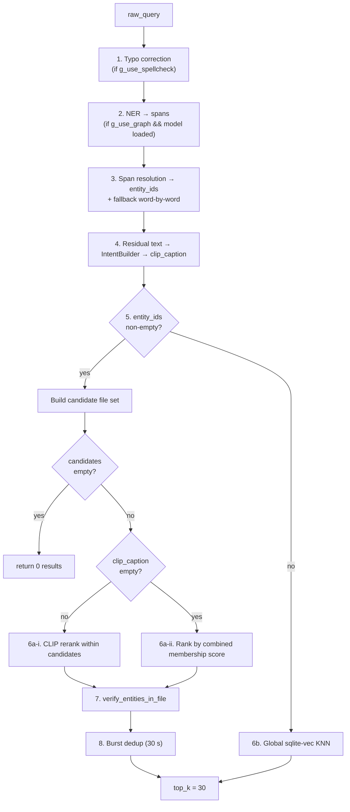

# 14 — The Search Pipeline

## The eight stages [VERIFIED-REPO — `query_engine.cpp::search_images`]



Three user-facing toggles gate this (`setSearchOptions(useGraph, useSpellCheck, useIntent)`):
disabling `useGraph` skips stages 2–3 entirely and forces the global-KNN path.

---

## Stage detail

### 1. Typo correction — `VantaProductionAnalyzer::analyze`

SymSpell-style: precompute the **delete neighbourhood** of every dictionary word up to edit distance 2, index it, and
at query time generate the query word's deletes and look them up. That converts an O(|dict|) scan into a hash probe.
Candidates are then verified with real Damerau-Levenshtein.

```
normalize_query()   lowercase; keep [a-z0-9 ]; collapse runs of >2 identical chars; trim
per token:
  len <= 2                         → untouched
  contains a digit                 → untouched  ("Zero-cost Digit Protection", protects mp4, gpt4)
  in whitelist or exact_matches    → untouched
  else                             → correct_token(): dist 1 first, then dist 2;
                                     accept only if confidence >= 0.75
                                     (conf: dist1 → 0.95, dist2 → 0.80, + up to 0.05 frequency boost)
```

**The dictionary is the weak point.** `SymSpellDictionary` is described in its own header as a *"Mock definition"*
and is constructed **empty**; the analyzer populates it from:
- **40 hardcoded static terms** (`me, myself, family, father, dad, mother, mom, brother, sister, friend, wife,
  husband, uncle, aunt, cousin, beach, mountain, kedarnath, temple, office, school, home, park, restaurant,
  graduation, birthday, wedding, diwali, holi, festival, vacation, trip, …`)
- every whitespace-separated token of every `entities.display_name`
- every whitespace-separated token of every `entities.relation`

Every entry gets a **faked frequency of 1000**, so the frequency tie-break is inert.

**Consequences:**
- ✅ It corrects exactly what matters: family terms and the user's own people's names. The dynamic half is genuinely
  clever — the dictionary personalises itself to the library.
- ❌ It cannot correct anything else. `"sunst"` stays `"sunst"` and CLIP gets a garbage token.
- ⚠️ `rebuild_query_engine_dictionary` is called on every rename/metadata edit and does
  `delete g_analyzer; g_analyzer = nullptr; init_query_engine(db_path);` — **with no lock**. See
  [07](./07_CPP_CORE_ENGINE.md): a concurrent search can be inside `g_analyzer` when it's freed.

### 2–3. NER and resolution

Covered in [12](./12_BERT_NER_QUERY_UNDERSTANDING.md). Key control flow:

- `SELF` span + owner set → `owner_entity_id`; owner **not** set → the span text is pushed into `unresolved_words`
  and handed to CLIP. Sensible degradation.
- `PERSON` / `RELATION` → `resolve_span_to_entity_id` (Damerau-Levenshtein ≤ 2 against `display_name` **and**
  `relation`). Unresolved → pushed to CLIP.
- Resolved IDs are sorted, deduped, and `-1` removed.
- If **nothing** resolved, `fallback_entity_resolution` retries word by word over the raw query.

### 4. The residual → CLIP caption

```cpp
// Remove any word already covered by a resolved span
for each word in corrected_query:
    covered = any resolved_span_text st. (st.find(word) != npos || word.find(st) != npos)
    if (!covered) cleaned += word
cleaned += unresolved_words          // put unresolvable person-words back for CLIP
if (!cleaned.empty()) {
    clip_caption = g_use_intent ? g_intent_builder->buildIntent("", cleaned) : cleaned;
    if (clip_caption.empty()) clip_caption = cleaned;             // whole-query fallback
    if (every word in clip_caption is a filler) clip_caption = "";  // ✅ good guard
}
```

> ⚠️ The substring-containment test for "covered" is loose: if an entity is named `"Ann"`, the word `"banner"`
> contains `"ann"` and would be dropped from the caption. Should be exact token equality.

> 🔴 **And this is where the Intent Builder can delete the query's meaning** — see
> [01 §C1](./01_VANTA_REALITY_CHECK.md). `"my dog at the beach"` → `"at a beach"`, losing `dog`.

### 5. Candidate set construction

| # entities | Path |
|---|---|
| 1 | `SELECT file_id FROM entity_memberships WHERE entity_id = ?` |
| 2 | `SELECT file_id FROM entity_relation_files WHERE entity_a = ? AND entity_b = ?` (canonical min/max) |
| ≥3, or 2 with an empty edge table | fetch each entity's membership set; pick the **smallest**; probe every element against the others |
| intersection empty | ⚠️ `require_all_entities = false`; take the **UNION** instead |
| still empty | **return 0 results immediately** (does not fall back to global KNN) |

That last row is a deliberate and defensible choice: *"if you asked for photos of two specific people and there are
none, returning random beach photos is worse than returning nothing."*

### 6a. Reranking within candidates

**With a CLIP caption:**
```cpp
tokens = tokenizer->encode(clip_caption);                     // BPE → 77 ids
query_embedding = clip_session->get_text_embedding(tokens);   // 512-d, L2-normalised
for (fid : candidate_file_ids) {
    SELECT file_id, embedding FROM clip_vec WHERE rowid = ?   // point lookup, not a KNN
    sim = dot_product(query_embedding, emb, 512);             // = cosine, both unit-norm
    scored.push_back({fid, sim});
}
sort desc; truncate to top_k;  res.distance = 1.0f - sim;
```

Note `WHERE rowid = ?` — this fetches a **specific** vector by id rather than running a KNN. That's exactly right:
the graph already chose the candidates, so this is a scan-and-score, not a search. Complexity is
**O(|candidates| × 512)**.

**Without a CLIP caption** (people-only query):
```cpp
combined = get_combined_membership_scores(db, entity_ids, candidates, require_all);
// for each file: MIN(score) across the required entities
sort desc; truncate; res.distance = 1.0f - score;
```
> 🔴 **This ranking is currently a no-op** — `entity_memberships.score` is always exactly 1.0, verified by
> execution. See [01 §A1](./01_VANTA_REALITY_CHECK.md). Every candidate ties, so results come back in
> `std::unordered_map` iteration order.
>
> The *intent* is right and worth stating: **min, not mean** — "a photo of me and mom is only as good as its worst
> face match", so one blurry, uncertain face should drag the whole photo down. That is the correct aggregation for a
> conjunctive constraint. It just needs a real score behind it.

### 7. Face verification

```sql
SELECT DISTINCT entity_id FROM face_detections WHERE file_id = ? AND entity_id IN (…)
-- require_all ? found.size() == entity_ids.size() : found.size() > 0
```
A second check against the authoritative per-detection table, guarding against stale `entity_memberships` rows (which
the merge pass can leave behind). Good defensive design.

> ⚠️ Bug: the SQL inlines the entity ids into the string **and** calls `sqlite3_bind_int64(stmt, 1, file_id)` — so
> `file_id` binds to parameter 1, which is `?` in `WHERE file_id = ?`. That happens to be correct because the
> `IN (…)` list is literal text with no placeholders. Fragile, but not broken.

> ⚠️ Applied **only in branch 6a**, not in the global-KNN branch.

### 8. Burst deduplication

```cpp
for (const auto& accepted : results)
    if (std::abs(accepted.mtime_unix - res.mtime_unix) < 30) { is_burst = true; break; }
```
Since `results` is already sorted by score, the first (best) photo of a burst wins. **O(n²)** over accepted
results — negligible at n ≤ 30. Also only in 6a.

---

## Four queries, traced end to end

### Query 1 — `"photos of me and mom at the beach"`

| Stage | Result |
|---|---|
| Typo | unchanged (all words whitelisted) |
| NER | `me → B-SELF`, `mom → B-RELATION`; rest `O` |
| Resolve | `me` → `g_owner_entity_id` = 3; `mom` → fuzzy match on `relation='mom'` → entity 7 |
| Residual | `"photos of and at the beach"` → drop covered spans → `"photos of and at the beach"` |
| IntentBuilder | `beach` ∈ `placesMap` → `"at a beach"`. No event, no people left → **`"at a beach"`** |
| Candidates | 2 entities → `entity_relation_files WHERE entity_a=3 AND entity_b=7` → say 42 files |
| Rerank | CLIP text embed of `"at a beach"`; fetch 42 vectors by rowid; dot product; sort |
| Verify | each file must contain **both** 3 and 7 in `face_detections` |
| Dedup | collapse bursts |
| **Out** | up to 30 beach photos containing both people, ranked by beachiness ✅ |

**This is the query the whole architecture exists for, and it works.** Say this one first.

### Query 2 — `"my graduation"`

| Stage | Result |
|---|---|
| NER | plausibly `my → O, graduation → O`; **no spans** |
| Fallback | word-by-word: `my` is a filler; `graduation` — `damerau_levenshtein("graduation", <any entity name>)` ≤ 2? Almost certainly not → **no entities** |
| Caption | `"my graduation"` → IntentBuilder: `graduation` ∈ `eventsMap` → **`"graduation ceremony"`** |
| Path | no candidates → **global KNN**: `SELECT file_id, distance FROM clip_vec WHERE embedding MATCH ? AND k = 30` |
| **Out** | 30 nearest photos to "graduation ceremony" ✅ |

⚠️ Note: **"my" is silently dropped.** The user meant *their own* graduation, and the owner-entity constraint is
never applied. A better pipeline would treat a bare possessive as a weak `SELF` signal. Also note **no burst dedup
and no face verification on this path**, so a burst of 20 near-identical graduation shots can fill the results.

### Query 3 — `"a dog running on grass"`

| Stage | Result |
|---|---|
| Typo | `"dog"`, `"running"`, `"grass"` are not in the 40-word dictionary → but they're also not corrected *to* anything (confidence < 0.75) → unchanged ✅ |
| NER | no spans (correctly — these aren't people) |
| Fallback | no entity within edit distance 2 → none |
| IntentBuilder | **no** word matches `eventsMap`/`placesMap`/`peopleMap` → returns `""` → **whole-query fallback** kicks in → `clip_caption = "a dog running on grass"` ✅ |
| Path | global KNN |
| **Out** | pure CLIP semantic search ✅ |

**This works precisely because nothing matched.** Contrast with `"my dog at the beach"`, where `beach` matches and
`dog` is silently deleted. That contrast is the cleanest way to explain the Intent Builder bug in an interview.

### Query 4 — `"me with dad at a temple"`

| Stage | Result |
|---|---|
| NER | `me → B-SELF`, `dad → B-RELATION` |
| Resolve | owner = 3; `dad` → entity 5 |
| Caption | residual `"with at a temple"` → `temple` ∈ `placesMap` → **`"near a temple"`** |
| Candidates | `entity_relation_files WHERE entity_a=3 AND entity_b=5` |
| ⚠️ If empty | falls back to the **UNION** of both memberships with `require_all=false` — so results may contain *only* dad, or *only* you. **Silently weaker than what was asked.** |
| Rerank | CLIP on `"near a temple"` |
| **Out** | ranked list ✅ (with the caveat above) |

---

## Reranking: the theory

### "Why not just return nearest neighbours from sqlite-vec?"

The answer has four parts, and this is a question you will be asked:

> "**1. The constraint isn't expressible as a similarity.** 'Photos of me and my mom' is a conjunctive set
> constraint. A single vector dot product is a graded, unconstrained similarity. You can't encode 'contains entity 7
> AND entity 12' in one query vector — you'd need a distinct vector per *combination* of people, which is
> combinatorial.
>
> **2. CLIP has no identity signal at all.** The tokens 'me' and 'mom' carry almost nothing for CLIP. A global KNN on
> that query returns generic photos of women at beaches — semantically plausible, exactly wrong.
>
> **3. Filtering first is also much cheaper.** Global KNN in sqlite-vec is a brute-force scan over every vector —
> 100,000 × 512 dot products. Graph filtering cuts that to the ~40 files that actually contain both people, and I
> then score only those. Two indexed SQL lookups plus 40 dot products beats 100,000 dot products by three orders of
> magnitude.
>
> **4. Each signal is used where it's authoritative.** The graph is *exact* about identity, so it should be a hard
> filter. CLIP is *approximate* about semantics, so it should be a soft ranker. Inverting that — ranking by identity
> similarity and filtering by CLIP score — would be strictly worse on both axes."

### Where precision and recall enter

| Stage | Optimises | Mechanism |
|---|---|---|
| Typo correction | **recall** | Prevents a misspelling from killing the query outright |
| NER + resolution | **precision** | Converts a fuzzy word into an exact entity constraint |
| Graph candidate selection | **precision** (hard filter) | Only files satisfying the constraint survive |
| UNION fallback | **recall at the cost of precision** | Deliberate — better to show *something* |
| Global KNN fallback | **recall** | Better to show semantically similar photos than nothing |
| CLIP rerank | **ordering quality** | Neither precision nor recall — it decides *what's at the top* |
| `verify_entities_in_file` | **precision** | Removes false positives from stale membership rows |
| Burst dedup | **result diversity** | Not accuracy — perceived quality |

### The score-fusion gap

There is **no score fusion in Vanta.** The two signals are used in strict sequence: the graph filters, then CLIP
ranks. The graph's own confidence (membership score, co-occurrence count, cluster confidence) never enters the
ranking function.

The natural improvement — and a good thing to propose:

$$\text{score}(f) = \alpha \cdot \underbrace{\cos(q_{\text{text}}, v_f)}_{\text{CLIP}} \;+\; \beta \cdot \underbrace{\min_i m_{i,f}}_{\text{weakest face match}} \;+\; \gamma \cdot \underbrace{r(f)}_{\text{recency}} \;+\; \delta \cdot \underbrace{q_f}_{\text{photo quality}}$$

with all terms normalised to [0,1] (CLIP cosine mapped by $(1+\cos)/2$, or min-max over the candidate set).

**Be honest about the catch:** you cannot tune α, β, γ, δ without an evaluation harness, and Vanta has none. The
right sequencing is: build a labelled query set → measure Recall@K and NDCG for the current pipeline → *then* add
fusion and prove it helps. Proposing weighted fusion without measurement is exactly the kind of unfalsifiable
improvement an interviewer will push back on — so pre-empt it.
