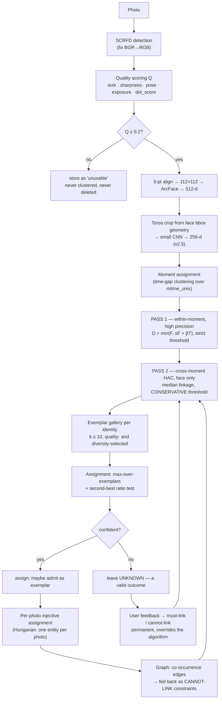

# 21 — Apple Photos Person Recognition vs. Vanta

> Source: **"Recognizing People in Photos Through Private On-Device Machine Learning"**, Apple Machine Learning
> Research, <https://machinelearning.apple.com/research/recognizing-people-photos>
>
> This is the single most relevant piece of prior art for Vanta, because it solves the **same problem under the same
> constraints**: unsupervised person clustering over a personal photo library, entirely on device, with no labels
> and no cloud. Every difference between their design and yours is a considered engineering decision you can learn
> from — and every one is a question you might be asked.

---

## Part 1 — What Apple does

### 1. Two embeddings, not one

Apple detects **faces and upper bodies**, and associates them with "a matching routine that takes into account
bounding box area and position, as well as the intersection of the face and upper body regions." Separate networks
embed each.

**Why upper body?** In real photos people are frequently turned away, occluded, too small, or looking down. The face
gives you nothing — but the person's torso, clothing and build still identify them *within a short time window*.

### 2. The combined distance metric — the paper's central idea

$$D_{ij} = \min\big(F_{ij},\; \alpha F_{ij} + \beta T_{ij}\big)$$

where $F$ = face-embedding distance and $T$ = upper-body distance. Three cases:

| Available | Behaviour |
|---|---|
| Face only | compare against the cluster's mean face embedding |
| Both | use the linear combination **only if the upper-body term helps** (hence the `min`) |
| Upper body only | use the torso distance alone |

The `min` is what makes it safe: **torso evidence can only ever improve a match, never veto one.**

**The critical constraint:** "upper body embeddings are less robust than face embeddings because they rely on a
person's temporary appearance — for example their clothing on a specific day." So upper-body comparisons are
performed **only within the same *moment***.

### 3. Moments

A **moment** "links together a collection of assets based on metadata such as time and location" — a birthday party,
an afternoon at the beach. Within a moment, clothing is stable, so torso matching is valid. Across moments, it isn't.

This is elegant: **a free metadata signal (time + location) gates when a weaker biometric signal is trustworthy.**

### 4. Two-pass clustering

| Pass | Method | Goal |
|---|---|---|
| **1** | Agglomerative clustering with the combined $D_{ij}$, within moments | **High precision**, producing "many, smaller clusters" |
| **2** | **Hierarchical agglomerative clustering (HAC)** using **face embeddings only**, across moment boundaries | "increasing recall significantly" |

Pass 2's linkage is "median distance between the members of two HAC clusters, and then switches to a random
sampling method when the number of comparisons gets significant."

**The performance payoff is striking:** at iteration 65, the optimised approach took **3.5 seconds** versus
**205.8 seconds** for typical average-linkage HAC — a ~59× speedup, which is what makes HAC viable on a phone at all.

**The strategy in one line: be conservative first, then merge deliberately.** Small pure clusters are cheap to
merge; impure clusters are expensive to split.

### 5. Canonical exemplars + sparse coding — explicitly *not* a centroid

Apple represents each cluster in the gallery with "a set of **canonical exemplars** $X_0, X_1, \dots X_c$." For a new
observation $y$, they solve a sparse-coding problem over the dictionary $D$ of all exemplars from all clusters:

$$\min_x \;\|y - Dx\|_2^2 + \lambda\|x\|_1$$

and assign $y$ to "the cluster corresponding to the maximum total *energy* of the sparse code."

**Why this is better than nearest-centroid** (and this is the heart of the comparison with Vanta):

- The $\ell_1$ penalty forces a **sparse** solution — $y$ is reconstructed from a *few* exemplars, not smeared
  across all of them.
- The decision is "which cluster's exemplars best *reconstruct* this face", not "which cluster's average is
  nearest". A multi-modal identity is represented by its actual modes.
- It is **competitive across all identities at once**: the dictionary contains every cluster's exemplars, so
  similar-looking people compete directly — which is exactly the sibling problem.
- The energy of the sparse code is a natural **confidence** signal. A face that no exemplar reconstructs well has
  low energy everywhere, and can be left unassigned.

### 6. Filtering unclear faces

An essential stage removes observations "not well represented as face and upper body embedding" — false positives
and out-of-distribution detections — because admitting them "would degrade gallery quality over time."

### 7. An explicit uncertainty branch

The model carries "an ad-hoc **embedding confidence branch**", fine-tuned on "random, non-face crop, as well as
out-of-domain data, to help the uncertainty branch detect anomalies in an input image that would render the
embedding less relevant."

So **the network itself reports when its own output shouldn't be trusted.** That is a fundamentally better answer
than inferring quality from a detector score.

### 8. Hard-example mining and fairness

Training uses a "**margin-mining softmax**" inspired by Support Vector Guided Softmax and CurricularFace, with "a
re-weighting function $f$ to modulate the similarity" for negative anchors, so the loss isn't "overwhelmed by a
large number of easy examples."

**The fairness result is the most important number in the paper for our purposes.** Across demographic subsets:

| Configuration | Worst subgroup | Best subgroup |
|---|---|---|
| No augmentation, large-margin softmax | **0.23** | 0.66 |
| Augmentations + margin-mining softmax | **0.86** | 0.96 |

The worst-performing subgroup improved from 0.23 to 0.86 — the method "not only significantly improves accuracy but
also helps **bridge the gap between sub-groups**." Augmentations included colour jitter, greyscale, flipping,
distortion, Gaussian blur, compression artifacts, cutout, and synthetic face masks generated from landmarks.

### 9. On-device performance

The model runs on the **Apple Neural Engine**, achieving **under 4 ms** inference — "an 8× improvement over an
equivalent model running on GPU." The architecture is AirFace-inspired with MobileNetV3-style bottlenecks, Squeeze-
and-Excitation channel attention, and a "linear global depth-wise convolution" instead of pooling for the final
embedding.

---

## Part 2 — The mapping table

| Apple technique | Vanta today | Missing | Benefit | Cost | Proposed adaptation for Vanta |
|---|---|---|---|---|---|
| **Face + upper-body embeddings** | Face only (ArcFace 512-d) | Upper-body detector + embedder | Recovers people who are turned away, occluded, or too small for face recognition — a large fraction of real photos | A second detector + second embedding model (~10–30 MB), more inference per photo, more storage | 🟡 **Medium priority.** Real benefit, real cost. A cheaper 80% version: use the **torso region derived from the existing face bbox** (a fixed geometric expansion downward) and embed it with a small generic CNN. No person detector needed |
| **Combined distance $\min(F, \alpha F + \beta T)$** | Plain cosine on face only | The fusion rule | Torso can only help, never hurt | trivial once you have $T$ | ✅ Adopt the `min` form exactly — the asymmetry is the whole insight |
| **Moments (time+location gating)** | ❌ none. `mtime_unix` is stored and indexed but used only for 30-second burst dedup | Event/moment clustering | Gates torso matching; enables "that trip last summer"; provides a strong prior that faces in one moment are the same cast of people | **Very low** — one pass over `mtime_unix` | ✅ **Highest value-to-cost ratio in the whole table.** Cluster files by time gaps into an `events` table. The data is already indexed |
| **Two-pass: precision-first, then recall** | Single online pass, then a *loose* merge pass (cos ≥ 0.50) | Conservative-first ordering | Small pure clusters merge safely; impure clusters can't be un-merged | Moderate refactor | ✅ **Adopt, and invert Vanta's thresholds.** Today Vanta merges (0.50) more loosely than it assigns (0.82) — the opposite of Apple's strategy. See [11 §Part 2.1](./11_FACE_CLUSTERING_AND_PERSON_SEGREGATION.md) |
| **HAC with median linkage + random sampling** | Greedy pairwise centroid comparison, O(n²) | Proper linkage; sampling for scale | Median linkage resists outliers far better than centroid linkage; sampling made it 59× faster in Apple's measurement | Implementation effort | 🟡 Adopt for the consolidation pass once entity counts grow. At a few hundred entities, O(n²) is fine |
| **Canonical exemplars** | 🔴 **One EMA "centroid" per person** | Multi-exemplar galleries | Directly fixes the multi-modal identity problem — Vanta's deepest flaw | *k*× storage (10 × 2 KB = 20 KB/person — trivial) and *k*× KNN probes | ✅ **The single highest-impact change.** It's a schema change, not an architecture change: `person_centroids` → `person_exemplars` in a `vec0` table, `k=1` → `k=5` + group-by-entity max |
| **Sparse-coding assignment** | Nearest-centroid, $k=1$ | $\ell_1$ reconstruction over a joint dictionary | Competitive across identities; energy = confidence | Needs an on-device sparse solver (LASSO/OMP); 512-d dictionary over all exemplars | 🟡 **Probably over-engineered for Vanta's scale.** A **max-over-exemplars score plus a second-best ratio test** captures most of the benefit for a fraction of the complexity. Say this — knowing when *not* to adopt is as valuable as adopting |
| **Filtering unclear faces** | 🔴 **None.** Every detection above `det_score > 0.5` is embedded and clustered, including 14-px blurry profiles | A quality gate | Prevents permanent gallery pollution; Apple explicitly says this is essential | Low — [11 §Part 4](./11_FACE_CLUSTERING_AND_PERSON_SEGREGATION.md) gives a composite score from data Vanta already has | ✅ **Adopt immediately.** Cheapest large win available |
| **Embedding confidence branch** | ❌ Uses `det_score` as a proxy — which measures "is this a face", not "is this face usable" | A learned uncertainty head | The network says when to distrust itself | Requires training/replacing the recogniser | 🟡 **The realistic substitute: MagFace or AdaFace**, where the pre-normalisation feature norm *is* a quality signal, for free. See [10](./10_FACE_RECOGNITION.md) |
| **OOD detection** | ❌ | — | Rejects non-faces and garbage crops | — | 🟡 Partially covered by the quality gate |
| **Margin-mining / hard-example training** | ❌ Uses a pretrained ArcFace; **no training at all** | — | Better embeddings, dramatically better fairness | Full training pipeline, large datasets, GPUs | ❌ **Out of scope, and say so plainly.** Vanta consumes a pretrained model; retraining a face recogniser is a different project |
| **Demographic fairness evaluation** | ❌ **None** | Per-subgroup evaluation | Apple's numbers (0.23 → 0.86 worst subgroup) show how large the effect is | Public benchmarks only — RFW, BUPT-Balancedface. **No user data needed** | ✅ **Adopt the evaluation even though you can't adopt the training.** See [19](./19_PRIVACY_SECURITY_FAIRNESS.md) |
| **Data augmentation** | n/a (no training) | — | — | — | ❌ n/a |
| **Dedicated NPU (ANE, <4 ms)** | 🔴 **CPU only.** ~50–100 ms/face **[ESTIMATED]** | Hardware acceleration | 10–25× faster face embedding | Android has no ANE equivalent; NNAPI is inconsistent and deprecated, QNN is vendor-specific | 🟡 **This is the one gap Vanta structurally cannot close.** Apple controls the silicon. The honest Android answer is XNNPACK first (still CPU, still deterministic), then per-vendor NPU as an opt-in |
| **On-device + private** | ✅ | — | — | — | ✅ **Vanta already matches Apple here, and that's worth saying.** Same constraint, same commitment |

---

## Part 3 — Vanta Person Recognition v2

A design that takes what's transferable from Apple and respects Android's actual constraints.



### Pseudocode

```cpp
// ── Stage 1: gate ──────────────────────────────────────────────────────────
float quality(const Detection& d, const cv::Mat& aligned) {
    float s_size   = std::min(1.0f, std::min(d.bbox.width, d.bbox.height) / 112.0f);
    float s_sharp  = std::tanh(laplacian_variance(aligned) / LAMBDA);
    float s_pose   = 1.0f - std::min(1.0f, affine_residual(d.keypoints) / R_MAX);
    float s_expo   = fraction_in_range(aligned, 10, 245);
    return 0.30f*s_size + 0.30f*s_sharp + 0.20f*s_pose + 0.10f*d.det_score + 0.10f*s_expo;
}

// ── Stage 2: scoring against an exemplar gallery (NOT a centroid) ──────────
struct Match { int64_t entity_id; float score; };

Match best_match(const Embedding& e, const Gallery& g) {
    // k=5 over person_exemplars, then collapse to max-per-entity
    auto hits = g.knn(e, /*k=*/5);                  // sqlite-vec MATCH on person_exemplars
    std::unordered_map<int64_t, float> per_entity;
    for (auto& h : hits)
        per_entity[h.entity_id] = std::max(per_entity[h.entity_id], h.similarity);
    // return best and remember second-best for the ratio test
    ...
}

// ── Stage 3: decide, and allow "I don't know" ──────────────────────────────
Decision assign(const Face& f, const Gallery& g, const PhotoContext& ctx) {
    if (f.quality < Q_MIN) return Decision::Unusable;

    auto [best, second] = best_two(f.emb, g);

    // Hard negative evidence, free from the graph: someone already claimed in this photo
    if (ctx.entity_already_assigned_in_this_photo(best.entity_id))
        return Decision::Defer;                    // resolved by the Hungarian pass below

    float tau = TAU_BASE + (1.0f - f.quality) * TAU_SLACK;   // quality-adaptive threshold

    if (best.score >= tau && (best.score - second.score) >= MARGIN)
        return Decision::Assign{best.entity_id, best.score};   // ← score goes into entity_memberships!
    if (best.score >= tau)
        return Decision::Tentative{best.entity_id, best.score};
    return Decision::Defer;                        // do NOT create an identity from one face
}

// ── Stage 4: per-photo injective assignment ────────────────────────────────
void resolve_photo(std::vector<Face>& faces, const Gallery& g) {
    // cost[i][j] = 1 - score(face_i, entity_j) over the top-m candidates per face
    // Hungarian / Jonker-Volgenant with a "dummy" column per face meaning "new/unknown"
    auto assignment = hungarian(build_cost_matrix(faces, g));
    // Guarantees: no entity is used twice in one photo.
}

// ── Stage 5: batch formation — identities need EVIDENCE ────────────────────
void form_new_identities(std::vector<Face>& deferred) {
    auto clusters = agglomerative_average_linkage(deferred, TAU_FORM);
    for (auto& c : clusters) {
        if (c.size() >= N_MIN && cohesion(c) >= C_MIN)   // N_MIN = 3
            create_identity(c);                          // seed the gallery with its best-quality members
        else
            mark_unknown(c);                             // an honest terminal state
    }
}

// ── Stage 6: consolidation — conservative, reversible, constraint-aware ────
void consolidate(Gallery& g, const Graph& graph) {
    for (auto& [a, b] : candidate_pairs_from_knn(g)) {       // NOT all pairs — O(n·k), not O(n²)
        if (graph.co_occur(a, b)) continue;                  // CANNOT-LINK: seen in the same photo
        if (user_said_different(a, b)) continue;             // user override is absolute
        float link = median_linkage(g.exemplars(a), g.exemplars(b));
        if (link >= TAU_MERGE) {                             // TAU_MERGE STRICTER than TAU_BASE
            merge_with_provenance(a, b);                     // log it → reversible
            transfer_graph_edges(a, b);                      // ← fixes the cascade bug
        }
    }
}
```

### Is every component feasible on mobile?

| Component | Feasible? | Why |
|---|---|---|
| Quality scoring | ✅ **Trivially** | One `cv::Laplacian` on a 112×112 crop; everything else is already computed |
| Exemplar gallery (k ≤ 10) | ✅ **Easily** | 20 KB per person; `k=5` on a table with a few thousand rows is microseconds in sqlite-vec |
| Ratio test | ✅ **Free** | Change `k=1` to `k=3` in a query that already exists |
| Moment clustering | ✅ **Free** | One pass over an already-indexed `mtime_unix` column |
| Hungarian per photo | ✅ | ≤10 faces → a 10×10 cost matrix → microseconds |
| Co-occurrence cannot-link | ✅ **Free** | The data is already in `entity_relations` |
| Agglomerative formation | ✅ | Over the deferred pool only (hundreds, not 150,000) |
| Median-linkage HAC | ✅ with sampling | Apple's own numbers show sampling is what makes it viable |
| **Upper-body embeddings** | 🟡 | A second model (+10–30 MB, +inference/photo). The geometric-torso-crop shortcut avoids a person detector |
| **Sparse-coding assignment** | 🟡 | Solvable, but max-over-exemplars + ratio captures most of the value. **Recommend skipping** |
| **Learned confidence branch** | ❌ as described | Requires retraining. Substitute MagFace/AdaFace |
| **NPU at <4 ms** | ❌ | No Android equivalent to the ANE with Apple's consistency |

### The prioritised roadmap

| Phase | Changes | Effort | Expected impact |
|---|---|---|---|
| **v2.0 — quality & correctness** | Quality gate; quality-weighted updates; **fix BGR→RGB**; **fix the aspect-ratio squash**; write a real `entity_memberships.score`; require N≥3 to form an identity; **invert the merge/assign thresholds** | ~1 week | 🔴 **Largest quality improvement per hour of work in the entire project** |
| **v2.1 — representation** | `person_centroids` → `person_exemplars`; max-over-exemplars scoring; ratio test | ~1 week | 🔴 Directly fixes the multi-modal identity problem |
| **v2.2 — constraints** | Hungarian per-photo assignment; co-occurrence cannot-link; merge provenance + transfer edges | ~1 week | 🟠 Fixes the sibling/family failure mode specifically |
| **v2.3 — structure** | Moments from `mtime_unix`; within-moment first pass; cross-moment HAC second pass | ~1–2 weeks | 🟠 Apple's core architecture, adapted |
| **v2.4 — feedback** | "Same person" / "not this person" UI → must-link / cannot-link constraints | ~1 week | 🟠 One user correction beats a hundred algorithmic guesses |
| **v2.5 — torso** | Geometric torso crop + small CNN embedder; $\min(F, \alpha F + \beta T)$ within moments | ~2–3 weeks | 🟡 Real recall gain on turned-away/occluded people |
| **v2.6 — model** | MagFace or AdaFace for a free quality signal | ~1 week + validation | 🟡 |

---

## Part 4 — The comparison, in interview form

> **"How does your face pipeline compare to Apple Photos?"**
>
> "Apple published their approach, and reading it was genuinely useful because we're solving the same problem under
> the same constraints — on-device, private, unsupervised, no labels. So the differences are informative rather than
> excuses.
>
> **Where I match them:** the overall shape is the same — detect, align, embed, cluster into identities the user
> names afterwards. And the privacy property is the same, and it's the reason both designs are hard.
>
> **Where they're substantially ahead, and I'd rank it in this order:**
>
> **One — they explicitly reject the centroid.** They represent each person by a set of *canonical exemplars* and
> assign a new face by sparse coding against a dictionary of all exemplars. I use a single vector, and worse, mine
> is an exponential moving average rather than even a true mean. A person's embeddings are multi-modal — frontal
> versus profile, with and without glasses, at different ages — and a single vector lands *between* the modes, where
> no real face of that person lives. That makes me simultaneously too far from the right faces and too close to the
> wrong ones. That's my deepest architectural flaw and it's the first thing I'd change.
>
> **Two — they filter unclear faces before clustering, and they have a learned confidence branch to do it.** I
> cluster everything above a 0.5 detector score, including 14-pixel motion-blurred profiles. Apple says explicitly
> that admitting those degrades the gallery over time, and they're right. I have no quality estimate at all.
>
> **Three — they're conservative first and permissive second.** Pass one is high-precision within moments; pass two
> grows recall deliberately. Mine is the wrong way round — I require cosine 0.82 for a single face to join a person,
> but I'll merge two entire identities at cosine 0.50. Those two numbers are inconsistent with each other, and the
> looser one governs the irreversible operation.
>
> **Four — upper-body embeddings gated by moments.** That's the idea I find most elegant: a weaker biometric signal
> made trustworthy by a free metadata signal. Clothing identifies you reliably *within a day* and not at all across
> months, so they only use it within a moment. I have no second signal and no notion of moments, even though
> `mtime_unix` is sitting indexed in my database.
>
> **Five — fairness.** Their margin-mining plus augmentation work moved the worst demographic subgroup from 0.23 to
> 0.86. I've done no fairness evaluation at all, and my thresholds are single global constants I tuned on one
> family's photos.
>
> **Where I genuinely can't follow them:** the Apple Neural Engine at under 4 ms per face. They control the silicon.
> On Android my realistic path is XNNPACK — still CPU, still deterministic across devices — rather than vendor NPUs.
>
> **And one place I'd deliberately not follow them:** the sparse-coding assignment. It's principled, but at my scale
> a max-over-exemplars score with a second-best ratio test gets most of the benefit for a fraction of the complexity.
> I'd take their *representation* insight without their solver."
