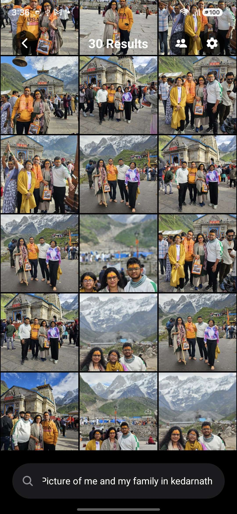
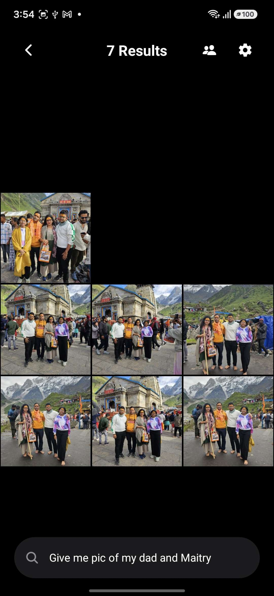
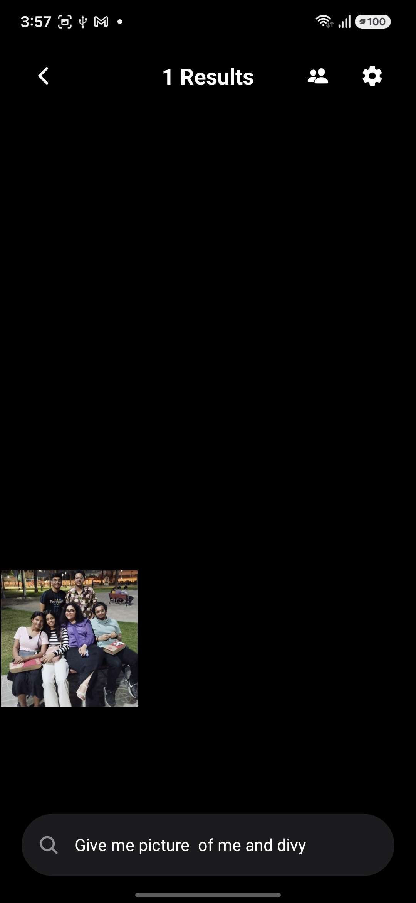
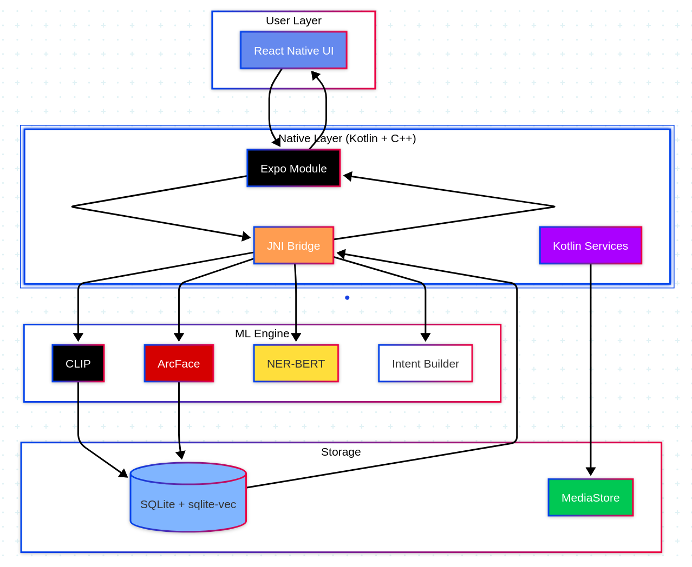

#  <span style="font-size: 1.5em;margin-left: 10px;">Vanta</span>

> **An on-device, privacy-first intelligent photo gallery with natural-language search, face recognition, and relational graph queries.**

Vanta is a React Native Android application that indexes your local media using on-device ML — no cloud, no uploads, no privacy compromises. It combines **CLIP** (visual-semantic understanding), **ArcFace** (face detection & recognition), **NER-BERT** (named entity recognition), and a **SQLite-vec** graph database to let you search your photos with sentences like *"pictures of me and my mom at the beach"*.

---

## Features

- **Natural Language Search** — Type what you remember: *"me and dad at the temple"*, *"graduation photos"*, *"beach sunset"*
- **Face Recognition & Clustering** — Automatically groups faces into people. Name them once, search by name or relation forever.
- **Relational Graph** — Understands *"my mom"*, *"my dad"*, *"my brother"* by linking named entities to relationship metadata.
- **On-Device Everything** — All models run locally via ONNX Runtime. No network required. No data leaves your phone.
- **Semantic Image Search** — CLIP embeddings understand visual concepts beyond just tags.
- **Document Indexing** — PDFs, Word docs, and text files are chunked and embedded for full-text semantic search.
- **Blazing Fast Performance** — Average end-to-end search latency of ~280ms across all query combinations (long/short, entity/relation, intent builder, and spell-checking), with rare peaks of ~430ms-450ms.

---

## Examples

<div align="center">
  
  
  
</div>

---

## Tech Stack

| Layer | Technology |
|-------|------------|
| **Frontend** | React Native (Expo) + TypeScript |
| **Native Bridge** | Expo Modules API + JNI (C++) |
| **ML Inference** | ONNX Runtime (C++) |
| **Vision Models** | CLIP-ViT-B/32 (image + text), ArcFace `buffalo_l` (face det + recognition) |
| **NLP** | DistilBERT NER (custom-trained for photo queries) |
| **Database** | SQLite + sqlite-vec (vector search extension) |
| **Build** | Android NDK, CMake, Gradle |

---

## Repository Structure

```
Vanta/
├── README.md                          # This file
├── DBschema.sql                       # SQLite schema (files, embeddings, entities, graph)
│
├── cpp/                               # Standalone C++ tools (model conversion, quantization)
│   ├── CLIP/                          # CLIP ONNX export helpers
│   └── Segregation/                   # Face model export helpers
│
├── produce_model/                     # Python scripts to convert PyTorch → ONNX
│   ├── get_onnx_CLIP.py
│   ├── quantize.py
│   └── convert_tosingle_file.py
│
├── Reads/                             # Architecture documentation (see below)
│   ├── 01-System-Architecture.md
│   ├── 02-Media-Ingestion-Pipeline.md
│   ├── 03-Indexing-Pipeline.md
│   ├── 04-Face-Recognition-Pipeline.md
│   ├── 05-Search-Query-Pipeline.md
│   ├── 06-Graph-Database.md
│   ├── 07-Database-Schema.md
│   ├── 08-JNI-Bridge.md
│   ├── 09-Model-Assets.md
│   └── 10-React-Native-Bridge.md
│
├── test_intent_builder                # Standalone C++ test binary for intent builder
│
└── vanta_app/                         # React Native application
    ├── App.tsx                        # Root navigator
    ├── screens/                       # UI screens
    │   ├── SearchScreen.tsx
    │   ├── PeopleScreen.tsx
    │   ├── EntityDetailScreen.tsx
    │   ├── SettingsScreen.tsx
    │   └── DebugScreen.tsx
    ├── modules/
    │   └── vanta-bridge/              # Expo native module
    │       ├── android/               # Kotlin service & module
    │       ├── ios/                   # iOS stubs (Swift)
    │       ├── cpp/                   # C++ engine (JNI + business logic)
    │       ├── src/                   # TypeScript types & module wrapper
    │       └── index.ts               # JS-facing API
    └── ...
```

---

## Quick Start

### Prerequisites

- Android Studio (latest)
- Node.js 18+ & npm
- Python 3.9+ (for model conversion)
- Android NDK (via Android Studio SDK Manager)

### 1. Clone & Install

```bash
git clone https://github.com/Aaryan-Degama/Vanta.git
cd Vanta/vanta_app
npm install
```

### 2. Extract Model Assets

Models are bundled in the APK assets and extracted on first launch. The app does this automatically, but you can pre-extract for development:

```bash
cd vanta_app
python download_models.py  # or manually place .onnx files in android/app/src/main/assets/VantaModels/
```

### 3. Build & Run

```bash
npx expo run:android
```

> **Note:** First build compiles the C++ engine via CMake + NDK. This can take 5–10 minutes.

### 4. Grant Permissions

The app needs media read permissions to scan your gallery. Grant when prompted.

---

## How It Works (High-Level)



---

## Architecture Documentation

Detailed pipeline documentation lives in [`Reads/`](./Reads/):

| Doc | What it covers |
|-----|---------------|
| [`01-System-Architecture.md`](./Reads/01-System-Architecture.md) | End-to-end system overview, data flow, component map |
| [`02-Media-Ingestion-Pipeline.md`](./Reads/02-Media-Ingestion-Pipeline.md) | MediaStore scanning, file classification, batching |
| [`03-Indexing-Pipeline.md`](./Reads/03-Indexing-Pipeline.md) | CLIP image embedding, face detection, storage |
| [`04-Face-Recognition-Pipeline.md`](./Reads/04-Face-Recognition-Pipeline.md) | Face detection, alignment, embedding, clustering, entity creation |
| [`05-Search-Query-Pipeline.md`](./Reads/05-Search-Query-Pipeline.md) | NER, intent building, graph traversal, CLIP re-ranking |
| [`06-Graph-Database.md`](./Reads/06-Graph-Database.md) | Entity graph, co-occurrence edges, membership scores |
| [`07-Database-Schema.md`](./Reads/07-Database-Schema.md) | Full SQL schema, indexes, virtual tables |
| [`08-JNI-Bridge.md`](./Reads/08-JNI-Bridge.md) | Kotlin ↔ C++ JNI bridge, type mapping, lifecycle |
| [`09-Model-Assets.md`](./Reads/09-Model-Assets.md) | ONNX models, quantization, model loading |
| [`10-React-Native-Bridge.md`](./Reads/10-React-Native-Bridge.md) | TypeScript API, hooks, error handling |

---

## License

Personal and Non-Commercial Use License (free to use, not free to sell) — see [`vanta_app/LICENSE`](./vanta_app/LICENSE)

---

## Developers

- **Aaryan Degama** ([@Aaryan-Degama](https://github.com/Aaryan-Degama))
- **Divy Vaghasiya** ([@Divy-21](https://github.com/Divy-21))

---

## Acknowledgements

- [OpenAI CLIP](https://github.com/openai/CLIP) — Visual-semantic embeddings
- [InsightFace](https://github.com/deepinsight/insightface) / ArcFace — Face recognition
- [ONNX Runtime](https://onnxruntime.ai/) — Cross-platform inference
- [sqlite-vec](https://github.com/asg017/sqlite-vec) — SQLite vector search extension
- [Hugging Face Transformers](https://huggingface.co/docs/transformers) — NER model training
