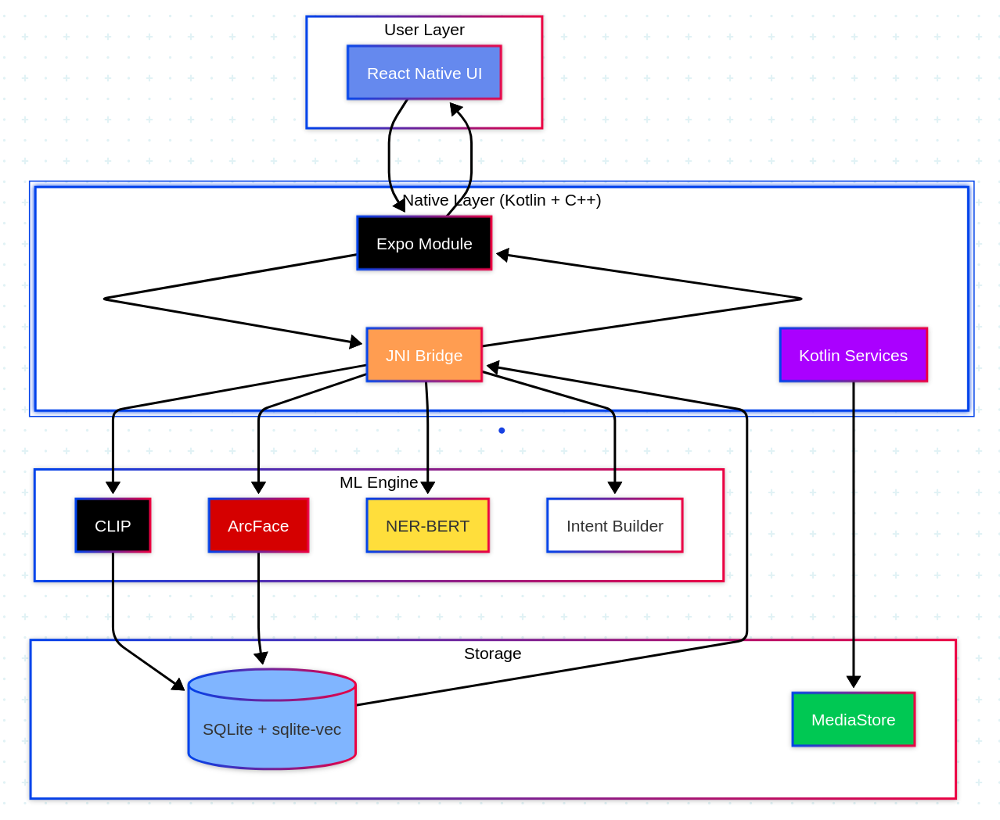
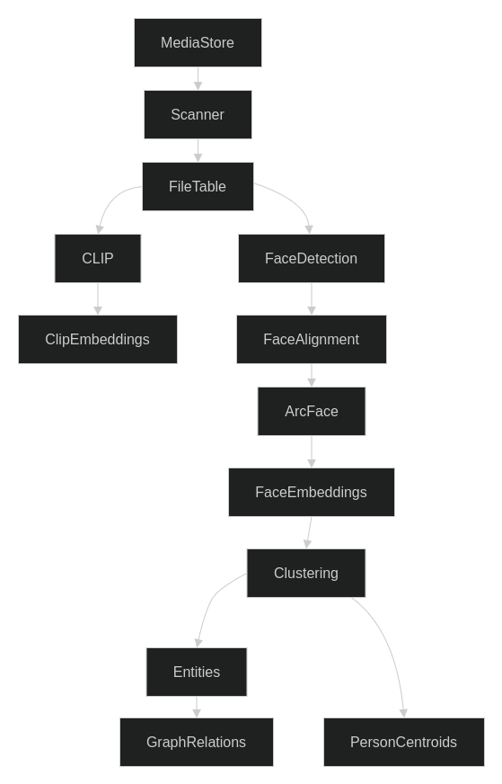
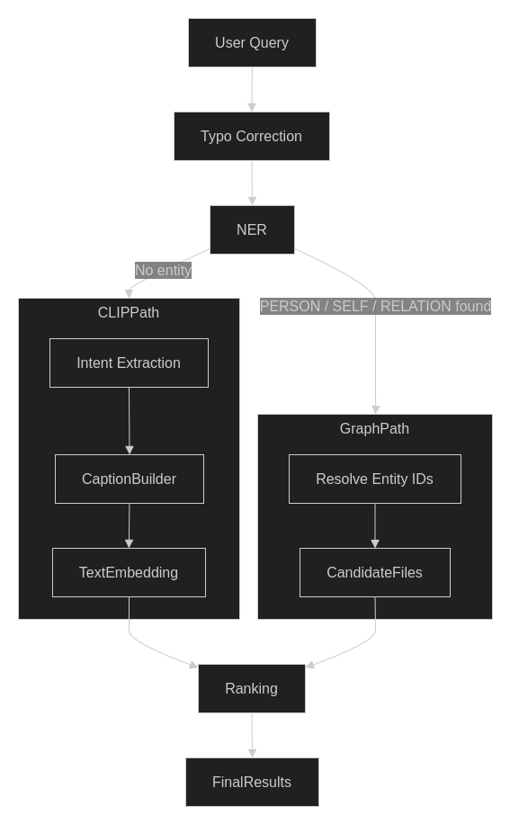

# 01 — System Architecture

> End-to-end overview of Vanta's components, data flow, and cross-layer interactions.

---

## Component Map

---

## Data Flow — Indexing

---

## Data Flow — Search

---

## Layer Responsibilities

| Layer | Language | Responsibility |
|-------|----------|---------------|
| **UI** | TypeScript / React Native | Screens, navigation, state management, user input |
| **Native Module** | Kotlin | Expo module definition, Android services, permissions, asset extraction |
| **JNI Bridge** | C++ | Type conversion, JVM interaction, global state management |
| **Engine** | C++ | ML inference, database queries, clustering, search logic |
| **Database** | SQLite/C | Persistent storage, vector search, graph relations |

---

## Threading Model

> **Rule:** `g_session_mutex` guards model loading. Inference (read-only) is thread-safe and does not need the mutex.

---

## Memory Model

