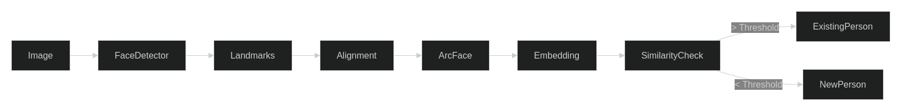
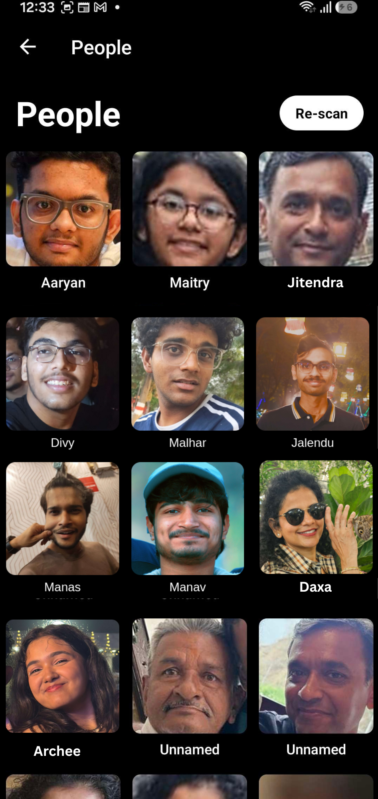

# 04 — Face Recognition & Clustering Pipeline

> How Vanta detects faces, generates embeddings, clusters them into people, and maintains quality avatars.

---

## Overview

The face pipeline transforms raw photos into **named, searchable person entities**. It runs inside the indexing loop, immediately after CLIP embedding generation.



---

## 1. Face Detection

### Model Architecture


### Detection Output

```cpp
struct FaceResult {
    float bbox[4];        // x1, y1, x2, y2 (pixel coords in original image)
    float det_score;      // confidence [0.0, 1.0]
    float keypoints[10];  // 5 pairs of (x,y) landmarks
};
```

**Landmark order:**
1. Left eye
2. Right eye
3. Nose
4. Left mouth corner
5. Right mouth corner

### Detection Preprocessing


---

## 2. Face Alignment

Alignment is critical for recognition accuracy. ArcFace uses 5-point similarity transform to warp faces to a canonical 112×112 frame.


**Why alignment matters:**
- Removes pose variation (tilt, rotation, scale)
- Normalizes eye/mouth positions
- Makes embeddings comparable across different photos
- Produces clean avatars for the People page

---

## 3. Face Embedding


**Model variants:**

| Variant | Backbone | Params | Size | Speed | Accuracy |
|---------|----------|--------|------|-------|----------|
| `buffalo_l` | ResNet50 | 43M | 43.8 MB | Medium | High |
| `buffalo_sc` | MobileFaceNet | 2M | 13.6 MB | Fast | Medium |

**L2 Normalization:**
```cpp
void l2Normalize(std::vector<float>& vec) {
    float norm = 0.0f;
    for (float v : vec) norm += v * v;
    norm = std::sqrt(norm);
    if (norm > 0) {
        for (float& v : vec) v /= norm;
    }
}
```

After normalization, the dot product of two embeddings equals their **cosine similarity** (range [-1, 1]).

---

## 4. Online Clustering

### Algorithm


### Why Incremental Centroids?

```
C_new = (C_old × n + E) / (n + 1)
```

This is the **online mean update**. It keeps the centroid as the average of all faces in the cluster, making it stable and representative.

**Alternative:** Exponential moving average (faster adaptation to appearance changes):
```
C_new = α × E + (1 - α) × C_old    where α = 0.1
```

---

## 5. Entity Lifecycle



### Entity Metadata

```sql
CREATE TABLE entities (
    entity_id INTEGER PRIMARY KEY AUTOINCREMENT,
    entity_type TEXT NOT NULL CHECK(entity_type IN ('person')),
    display_name TEXT,           -- "Aaryan", "Mom", "Dad"
    confidence REAL DEFAULT 1.0, -- cluster quality score
    sample_count INTEGER DEFAULT 0,
    created_at INTEGER NOT NULL,
    updated_at INTEGER NOT NULL
);
```

### Setting Metadata (from UI)


---

## 6. Avatar Selection (Best Face Crop)

The People page shows one representative face per entity. Selection criteria:


**Current limitation:** The avatar is cropped from the original image using the bounding box. For Samsung-quality avatars, use the **pre-aligned 112×112 crop** instead.

---

## 7. Quality Scoring (Recommended Enhancement)

For better avatar quality, compute a composite quality score during indexing:


**Formula:**
```
quality = sharpness×0.35 + frontal×0.25 + size×0.15 + eye_openness×0.25
```

---

## 8. Reclustering & Merge Passes

### Second Pass: Recluster Pending

Some faces fail to match during online clustering (e.g., first photo of a person with poor lighting). After all files are indexed, unmatched faces are re-evaluated against the full centroid set.

### Third Pass: Entity Merge

Over time, the same person may split into multiple clusters. The merge pass compares all entity centroids pairwise:


