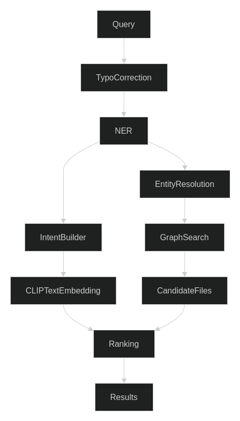
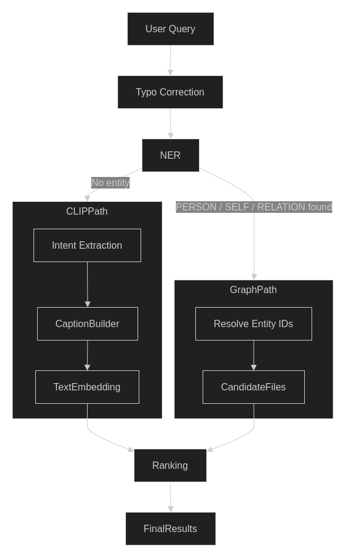
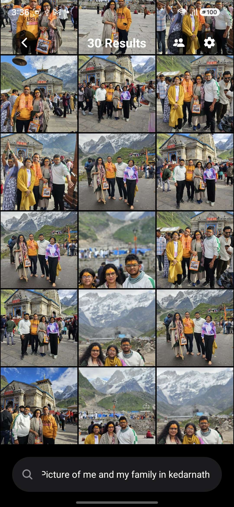
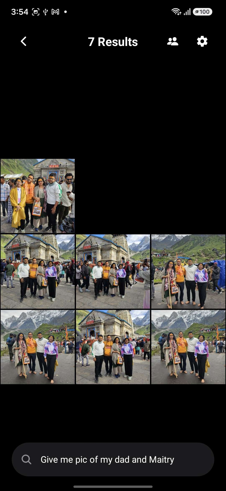
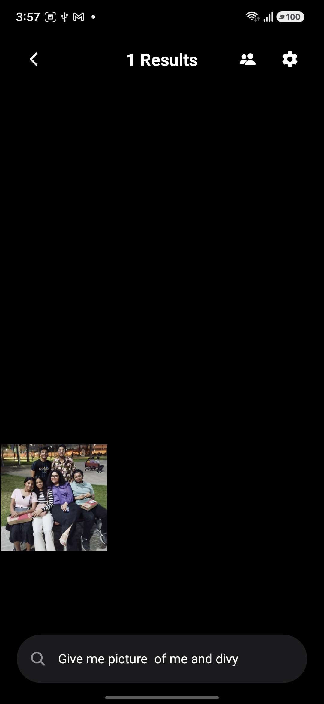

# 05 — Search & Query Pipeline

> How Vanta transforms a natural language query into ranked photo results.

---

## Overview

The search pipeline is a **hybrid AI + graph system**. It combines:

1. **NER-BERT** — extracts people, relations, and visual concepts from text
2. **Intent Builder** — converts unresolved text into CLIP-friendly captions
3. **Graph Traversal** — finds files where all requested people co-occur
4. **CLIP Re-ranking** — scores candidates by visual-semantic similarity
5. **Typo Correction** — fixes spelling errors before NER runs



---

## Step 1: Typo Correction

Before NER runs, the query is spell-checked using **SymSpell** (Symmetric Delete spelling correction algorithm).


**Whitelist sources:**
- Static terms: `me`, `myself`, `mom`, `dad`, `beach`, `mountain`, `graduation`, ...
- Dynamic terms: All `display_name` values from `entities` table
- Dynamic terms: All `relation` values from `entities` table

**Rebuilding:** The whitelist is rebuilt whenever an entity is named or renamed.

---

## Step 2: NER Extraction

### Model


**Label map:**
```json
{
  "0": "O",       // Outside (not an entity)
  "1": "B-SELF",  // Beginning of SELF reference
  "2": "I-SELF",  // Inside SELF reference
  "3": "B-PERSON",// Beginning of person name
  "4": "I-PERSON",// Inside person name
  "5": "B-RELATION", // Beginning of relation
  "6": "I-RELATION"  // Inside relation
}
```

### Span Extraction Example

| Query | Tokens | Labels | Spans |
|-------|--------|--------|-------|
| `me and my mom at the beach` | `me` `and` `my` `mom` `at` `the` `beach` | `B-SELF` `O` `O` `B-RELATION` `O` `O` `O` | `[me→SELF]`, `[mom→RELATION]` |
| `aaryans pictures` | `aaryans` `pictures` | `B-PERSON` `O` | `[aaryans→PERSON]` |
| `show me photos of dad` | `show` `me` `photos` `of` `dad` | `O` `B-SELF` `O` `O` `B-RELATION` | `[me→SELF]`, `[dad→RELATION]` |

---

## Step 3: Entity Resolution

Each span is mapped to a concrete `entity_id` in the database.


### Resolution Algorithm

```cpp
int64_t resolve_span_to_entity_id(
    const std::string& span_text,
    const std::vector<EntityCandidate>& candidates,
    int64_t owner_entity_id
) {
    std::string lower = to_lower(span_text);
    // Strip "my " prefix and "'s" possessive suffix
    
    int best_dist = 3;  // Max allowed distance
    int64_t best_id = -1;
    
    for (const auto& c : candidates) {
        int d = min(
            damerau_levenshtein(lower, to_lower(c.display_name)),
            damerau_levenshtein(lower, to_lower(c.relation))
        );
        if (d < best_dist) {
            best_dist = d;
            best_id = c.entity_id;
        }
    }
    return best_dist <= 2 ? best_id : -1;
}
```

### Fallback Entity Extraction

When NER returns zero spans (e.g., misspelled name not caught by SymSpell), the engine falls back to **word-by-word entity matching** against the known entity dictionary.


---

## Step 4: Candidate File Selection

Based on resolved entity IDs, the engine builds a candidate file set:


**Multi-entity intersection (3+ entities):**
1. Query `entity_memberships` for each entity individually
2. Find the entity with the smallest result set (optimization)
3. Check every file in that set against all other entity sets
4. Only keep files present in **all** sets

---

## Step 5: CLIP Caption Building

Unresolved text (visual context) is converted to a CLIP-friendly caption:


**Intent Builder mappings (examples):**

| Input Word/Phrase | CLIP Caption |
|-------------------|-------------|
| `beach` | `beach scene` |
| `mountain` | `mountain landscape` |
| `graduation` | `graduation ceremony` |
| `birthday` | `birthday party` |
| `wedding` | `wedding ceremony` |
| `office` | `office workspace` |
| `restaurant` | `restaurant dining` |
| `park` | `park outdoor` |
| `temple` | `temple architecture` |
| `festival` | `festival celebration` |

If no mapping exists, the raw text is used as the caption.

---

## Step 6: Ranking

### Scenario A: Visual Context Present (CLIP Ranking)


### Scenario B: People Only (Graph Ranking)


**Combined score rationale:** A photo of "me and my mom" is only as good as its worst face match. If mom is blurry and far away, the photo shouldn't rank highly even if I'm perfectly in focus.

---

## Step 7: Face Verification

Before returning a result, the engine verifies that every required entity actually has a face detection in that specific file:


This prevents false positives from `entity_memberships` stale data.

---

## Step 8: Burst Shot Deduplication

Consecutive photos taken within 30 seconds are considered "burst shots" and only the best one is kept:


---

## Complete Search Flow Diagram



---

## Query Examples & Pipeline Behavior

<p align="center">
  
  
  
</p>

| Query | NER Spans | Resolved Entities | CLIP Caption | Candidate Source | Ranking |
|-------|-----------|-------------------|--------------|----------------|---------|
| `me and my mom` | `SELF`, `RELATION` | Owner + Mom | *(none)* | `entity_relation_files` | Graph min-score |
| `aaryan at beach` | `PERSON`, `UNRESOLVED` | Aaryan | `beach scene` | `entity_memberships` | CLIP similarity |
| `pictures of dad` | `RELATION` | Dad | *(none)* | `entity_memberships` | Graph score |
| `sunset photos` | *(none)* | *(none)* | `sunset photos` | Global KNN | CLIP similarity |
| `me and my brother at school` | `SELF`, `RELATION`, `UNRESOLVED` | Owner + Brother | `school campus` | Intersection | Combined then CLIP |
| `aaryans pictures` | *(none)* | Aaryan (fallback) | *(none)* | `entity_memberships` | Graph score |

---

## Performance Characteristics

| Step | Latency | Notes |
|------|---------|-------|
| Typo correction | ~1-2 ms | In-memory SymSpell |
| NER inference | ~20-50 ms | DistilBERT ONNX, CPU |
| Entity resolution | ~1-5 ms | SQLite + string distance |
| Candidate lookup | ~1-10 ms | Indexed SQLite queries |
| CLIP text embedding | ~30-60 ms | ONNX Runtime |
| Image embedding lookup | ~1-5 ms | sqlite-vec KNN |
| Dot product ranking | ~1-5 ms | Pure C++ math |
| **Total (Average)** | **~280 ms** | End-to-end across all prompt types (long/short, entity/relation, intent builder, spell check) |
| **Total (Maximum)** | **~430-450 ms** | Rare edge cases |
