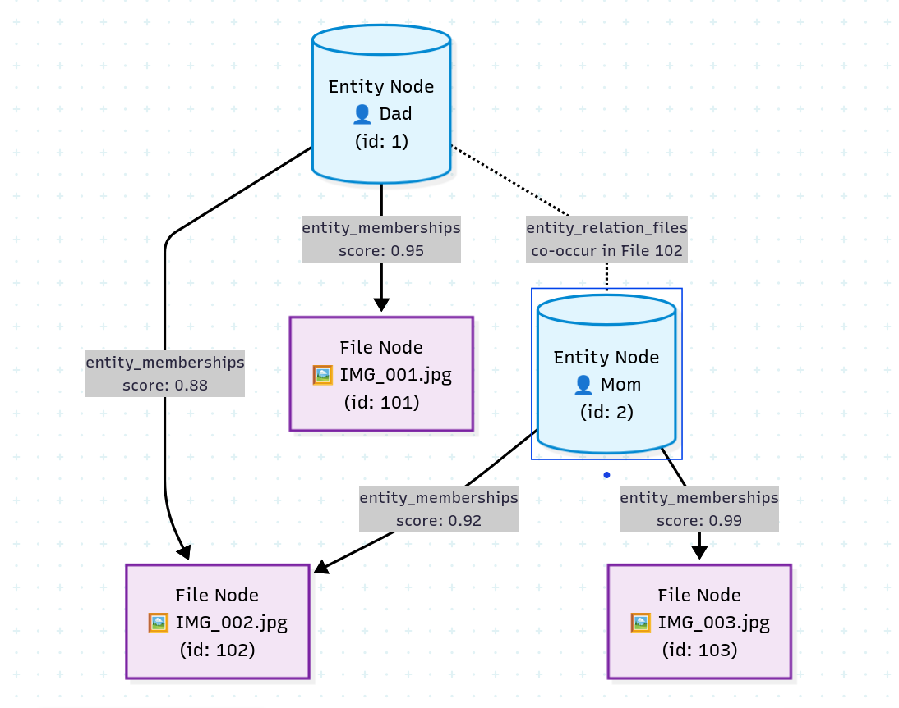

# 06 — Graph Database

> How Vanta models people, their relationships, and co-occurrences as a graph inside SQLite.

---

## Overview

Vanta doesn't use a dedicated graph database. Instead, it implements a **property graph** on top of SQLite using relational tables and the `sqlite-vec` extension for vector search. The graph is implicit in the relationships between `entities`, `files`, `face_detections`, and `entity_relation_files`.




---

## Graph Nodes

### Entity Node

```sql
CREATE TABLE entities (
    entity_id INTEGER PRIMARY KEY AUTOINCREMENT,
    entity_type TEXT NOT NULL CHECK(entity_type IN ('person')),
    display_name TEXT,              -- Human-readable name
    relation TEXT,                  -- "mom", "dad", "brother", "friend"
    confidence REAL DEFAULT 1.0,    -- Cluster quality
    sample_count INTEGER DEFAULT 0, -- Number of face samples
    created_at INTEGER NOT NULL,
    updated_at INTEGER NOT NULL
);
```

**Node properties:**
- `entity_type`: Currently only `person`. Extensible to `pet`, `place`, `object` in future.
- `display_name`: User-assigned label (e.g., "Aaryan", "Mom")
- `relation`: Semantic relationship to the app owner (e.g., "mom", "dad")
- `confidence`: Cluster cohesion score (higher = more consistent faces)
- `sample_count`: How many face detections belong to this entity

### File Node

```sql
CREATE TABLE files (
    id INTEGER PRIMARY KEY AUTOINCREMENT,
    media_id INTEGER,
    content_uri TEXT NOT NULL,
    abs_path TEXT NOT NULL UNIQUE,
    display_name TEXT,
    filetype TEXT NOT NULL CHECK(filetype IN ('picture','document','audio','video')),
    mime_type TEXT,
    size_bytes INTEGER,
    mtime_unix INTEGER,
    last_indexed_at INTEGER DEFAULT 0,
    width_px INTEGER DEFAULT 0,
    height_px INTEGER DEFAULT 0,
    duration_ms INTEGER DEFAULT 0,
    status TEXT DEFAULT 'pending' CHECK(status IN ('pending','indexed','failed','skipped')),
    retry_count INTEGER DEFAULT 0,
    face_count INTEGER DEFAULT 0
);
```

---

## Graph Edges

### Edge Type 1: Entity → File (Membership)

```sql
CREATE TABLE entity_memberships (
    entity_id INTEGER NOT NULL,
    file_id INTEGER NOT NULL,
    score REAL DEFAULT 0.0,
    PRIMARY KEY (entity_id, file_id),
    FOREIGN KEY (entity_id) REFERENCES entities(entity_id),
    FOREIGN KEY (file_id) REFERENCES files(id)
);
```

**Semantics:** Entity `entity_id` appears in file `file_id` with confidence `score`.

**Score computation:** The average cosine similarity between the face embedding in this file and the entity's centroid.


### Edge Type 2: Entity ↔ Entity (Co-occurrence)

```sql
CREATE TABLE entity_relation_files (
    entity_a INTEGER NOT NULL,
    entity_b INTEGER NOT NULL,
    file_id INTEGER NOT NULL,
    co_occurrence_count INTEGER NOT NULL DEFAULT 1,
    PRIMARY KEY (entity_a, entity_b, file_id),
    FOREIGN KEY (entity_a) REFERENCES entities(entity_id),
    FOREIGN KEY (entity_b) REFERENCES entities(entity_id),
    FOREIGN KEY (file_id) REFERENCES files(id)
);
```

**Semantics:** Entities `entity_a` and `entity_b` appear together in `file_id`. `co_occurrence_count` tracks how many times they've been seen together (for future weighting).

**Normalization:** `entity_a < entity_b` always (sorted pair). This prevents duplicate edges and makes lookups deterministic.


### Edge Type 3: File → Embedding (Vector)

```sql
CREATE VIRTUAL TABLE clip_vec USING vec0(
    file_id INTEGER PRIMARY KEY,
    embedding FLOAT[512]
);

CREATE VIRTUAL TABLE face_vec USING vec0(
    detection_id INTEGER PRIMARY KEY,
    embedding FLOAT[512]
);

CREATE VIRTUAL TABLE person_centroids USING vec0(
    entity_id INTEGER PRIMARY KEY,
    embedding FLOAT[512]
);
```

These are **sqlite-vec** virtual tables. They store high-dimensional vectors and support KNN (k-nearest neighbor) queries via `MATCH` operator.

---

## Graph Traversal Patterns

### Pattern 1: Single Person → All Their Photos

```sql
SELECT f.id, f.abs_path, f.display_name
FROM files f
JOIN entity_memberships em ON f.id = em.file_id
WHERE em.entity_id = ?
ORDER BY em.score DESC;
```


### Pattern 2: Two People → Photos Together

```sql
SELECT f.id, f.abs_path
FROM entity_relation_files erf
JOIN files f ON f.id = erf.file_id
WHERE erf.entity_a = ? AND erf.entity_b = ?
ORDER BY erf.co_occurrence_count DESC;
```


### Pattern 3: Three+ People → Intersection

```sql
-- Find files where ALL three entities appear
SELECT f.id
FROM files f
WHERE f.id IN (
    SELECT file_id FROM entity_memberships WHERE entity_id = ?
)
AND f.id IN (
    SELECT file_id FROM entity_memberships WHERE entity_id = ?
)
AND f.id IN (
    SELECT file_id FROM entity_memberships WHERE entity_id = ?
);
```


**Optimization:** Find the entity with the smallest membership set first, then filter.

### Pattern 4: Semantic + Graph Hybrid

```sql
-- Find photos of "me and mom" that also match "beach"
WITH candidates AS (
    SELECT file_id FROM entity_relation_files
    WHERE entity_a = ? AND entity_b = ?
)
SELECT f.id, f.abs_path, vec_distance(embedding, ?) as distance
FROM clip_vec
JOIN files f ON f.id = clip_vec.file_id
WHERE clip_vec.file_id IN candidates
ORDER BY distance ASC
LIMIT 30;
```

---

## Graph Maintenance

### During Indexing


### After Entity Merge

When two entities are merged:


### After Entity Rename

When a user renames an entity:


---

## Graph Queries in Search

### Query: "me and my mom"


### Query: "me and my mom at the beach"


---

## Future Extensions

| Feature | Schema Change | Query Impact |
|---------|--------------|--------------|
| **Temporal edges** | Add `taken_at` to `entity_relation_files` | "me and mom in 2023" |
| **Location edges** | Add `location_id` to `files` | "me and mom in Paris" |
| **Event nodes** | New `events` table + `file_event` junction | "me and mom at graduation" |
| **Object nodes** | Extend `entities` to `entity_type='object'` | "me and my car" |
| **Weighted edges** | Add `strength` to `entity_relation_files` | "closest friends first" |

---

## Performance Notes

| Operation | Index | Typical Time |
|-----------|-------|--------------|
| Single entity membership lookup | `entity_memberships(entity_id)` | ~1-5 ms |
| Co-occurrence lookup | `entity_relation_files(entity_a, entity_b)` | ~1-5 ms |
| Multi-entity intersection | `entity_memberships(entity_id, file_id)` | ~5-20 ms |
| KNN vector search | `sqlite-vec` virtual index | ~10-50 ms |
| Full graph traversal | Multiple joins | ~20-100 ms |
