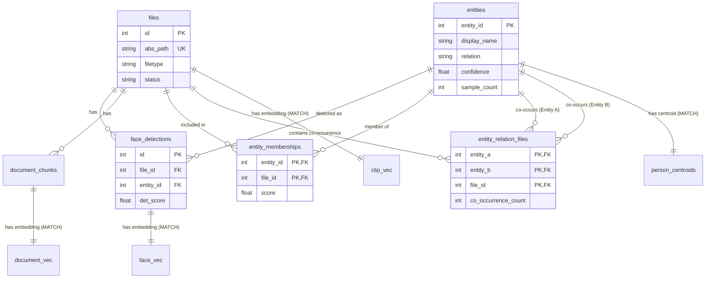

# 07 — Database Schema

> Complete reference for Vanta's SQLite database — tables, indexes, virtual tables, and constraints.

---

## Schema Overview


---

## Table Definitions

### `files` — Media Registry

```sql
CREATE TABLE files (
    id INTEGER PRIMARY KEY AUTOINCREMENT,
    media_id INTEGER,
    content_uri TEXT NOT NULL,
    abs_path TEXT NOT NULL UNIQUE,
    display_name TEXT,
    filetype TEXT NOT NULL CHECK(filetype IN ('picture','document','audio','video')),
    mime_type TEXT,
    size_bytes INTEGER,
    mtime_unix INTEGER,
    last_indexed_at INTEGER DEFAULT 0,
    width_px INTEGER DEFAULT 0,
    height_px INTEGER DEFAULT 0,
    duration_ms INTEGER DEFAULT 0,
    status TEXT DEFAULT 'pending' CHECK(status IN ('pending','indexed','failed','skipped')),
    retry_count INTEGER DEFAULT 0,
    face_count INTEGER DEFAULT 0
);
```

**Purpose:** The canonical registry of every media file discovered on the device.

**Key constraints:**
- `abs_path UNIQUE` — Prevents duplicate entries across re-scans
- `status CHECK` — State machine: pending → indexed/failed/skipped
- `filetype CHECK` — Validated classification

**Indexes:**
```sql
CREATE INDEX idx_files_status ON files(status);
CREATE INDEX idx_files_filetype ON files(filetype);
CREATE INDEX idx_files_mtime ON files(mtime_unix);
```

---

### `clip_vec` — CLIP Image Embeddings (Virtual)

```sql
CREATE VIRTUAL TABLE clip_vec USING vec0(
    file_id INTEGER PRIMARY KEY,
    embedding FLOAT[512]
);
```

**Purpose:** Stores 512-dimensional CLIP visual embeddings for semantic image search.

**Engine:** `sqlite-vec` — provides KNN search via `MATCH` operator.

**Query example:**
```sql
-- KNN search: find 30 most similar images to a query vector
SELECT file_id, distance
FROM clip_vec
WHERE embedding MATCH ?
  AND k = 30;
```

---

### `face_detections` — Face Bounding Boxes

```sql
CREATE TABLE face_detections (
    id INTEGER PRIMARY KEY AUTOINCREMENT,
    file_id INTEGER NOT NULL,
    entity_id INTEGER,
    bbox_x INTEGER NOT NULL,
    bbox_y INTEGER NOT NULL,
    bbox_w INTEGER NOT NULL,
    bbox_h INTEGER NOT NULL,
    det_score REAL NOT NULL,
    aligned_crop_path TEXT,
    quality_score REAL DEFAULT 0.0,
    created_at INTEGER NOT NULL,
    FOREIGN KEY (file_id) REFERENCES files(id) ON DELETE CASCADE,
    FOREIGN KEY (entity_id) REFERENCES entities(entity_id) ON DELETE SET NULL
);
```

**Purpose:** Records every face detected in every image, including bounding box, confidence, and (optionally) the aligned crop path.

**Key fields:**
- `entity_id` — NULL until clustering assigns it; re-NULL on entity deletion
- `det_score` — Face detector confidence [0, 1]
- `aligned_crop_path` — Path to pre-aligned 112×112 crop (optional, for avatar quality)
- `quality_score` — Composite face quality metric (optional, for avatar ranking)

**Indexes:**
```sql
CREATE INDEX idx_face_detections_file_id ON face_detections(file_id);
CREATE INDEX idx_face_detections_entity_id ON face_detections(entity_id);
CREATE INDEX idx_face_detections_score ON face_detections(det_score);
```

---

### `face_vec` — Face Recognition Embeddings (Virtual)

```sql
CREATE VIRTUAL TABLE face_vec USING vec0(
    detection_id INTEGER PRIMARY KEY,
    embedding FLOAT[512]
);
```

**Purpose:** Stores 512-dimensional ArcFace embeddings for face clustering and similarity search.

**Relationship:** One-to-one with `face_detections.id`.

---

### `entities` — Person Entities

```sql
CREATE TABLE entities (
    entity_id INTEGER PRIMARY KEY AUTOINCREMENT,
    entity_type TEXT NOT NULL CHECK(entity_type IN ('person')),
    display_name TEXT,
    relation TEXT,
    confidence REAL DEFAULT 1.0,
    sample_count INTEGER DEFAULT 0,
    created_at INTEGER NOT NULL,
    updated_at INTEGER NOT NULL
);
```

**Purpose:** Represents a clustered person (or future: pet, place, object).

**Key fields:**
- `display_name` — User-assigned name (e.g., "Aaryan", "Mom")
- `relation` — Semantic relationship to app owner (e.g., "mom", "dad", "brother")
- `confidence` — Cluster quality (0-1, higher = more consistent)
- `sample_count` — Number of face detections in this cluster

**Indexes:**
```sql
CREATE INDEX idx_entities_display_name ON entities(display_name);
CREATE INDEX idx_entities_relation ON entities(relation);
CREATE INDEX idx_entities_type ON entities(entity_type);
```

---

### `person_centroids` — Cluster Centroids (Virtual)

```sql
CREATE VIRTUAL TABLE person_centroids USING vec0(
    entity_id INTEGER PRIMARY KEY,
    embedding FLOAT[512]
);
```

**Purpose:** Stores the average embedding of all faces in an entity cluster. Used for online clustering of new faces.

**Update rule:** Incremental mean
```
new_centroid = (old_centroid * n + new_embedding) / (n + 1)
```

---

### `entity_memberships` — Entity-File Edges

```sql
CREATE TABLE entity_memberships (
    entity_id INTEGER NOT NULL,
    file_id INTEGER NOT NULL,
    score REAL DEFAULT 0.0,
    PRIMARY KEY (entity_id, file_id),
    FOREIGN KEY (entity_id) REFERENCES entities(entity_id) ON DELETE CASCADE,
    FOREIGN KEY (file_id) REFERENCES files(id) ON DELETE CASCADE
);
```

**Purpose:** Many-to-many relationship: which entities appear in which files, with a quality score.

**Score:** Cosine similarity between the face embedding in this file and the entity's centroid.

**Indexes:**
```sql
CREATE INDEX idx_memberships_entity ON entity_memberships(entity_id);
CREATE INDEX idx_memberships_file ON entity_memberships(file_id);
```

---

### `entity_relation_files` — Co-occurrence Edges

```sql
CREATE TABLE entity_relation_files (
    entity_a INTEGER NOT NULL,
    entity_b INTEGER NOT NULL,
    file_id INTEGER NOT NULL,
    co_occurrence_count INTEGER NOT NULL DEFAULT 1,
    PRIMARY KEY (entity_a, entity_b, file_id),
    FOREIGN KEY (entity_a) REFERENCES entities(entity_id) ON DELETE CASCADE,
    FOREIGN KEY (entity_b) REFERENCES entities(entity_id) ON DELETE CASCADE,
    FOREIGN KEY (file_id) REFERENCES files(id) ON DELETE CASCADE
);
```

**Purpose:** Records when two entities appear together in the same file.

**Normalization:** `entity_a < entity_b` always (sorted pair).

**Indexes:**
```sql
CREATE INDEX idx_relations_a ON entity_relation_files(entity_a);
CREATE INDEX idx_relations_b ON entity_relation_files(entity_b);
CREATE INDEX idx_relations_file ON entity_relation_files(file_id);
```

---

### `document_chunks` — Text Document Chunks

```sql
CREATE TABLE document_chunks (
    chunk_id INTEGER PRIMARY KEY AUTOINCREMENT,
    file_id INTEGER NOT NULL,
    chunk_index INTEGER NOT NULL,
    chunk_text TEXT NOT NULL,
    created_at INTEGER NOT NULL,
    FOREIGN KEY (file_id) REFERENCES files(id) ON DELETE CASCADE
);
```

**Purpose:** Stores text chunks extracted from documents (PDF, DOCX, TXT) for semantic search.

**Chunking strategy:** Typically 512 tokens per chunk with 128-token overlap.

---

### `document_vec` — Document Chunk Embeddings (Virtual)

```sql
CREATE VIRTUAL TABLE document_vec USING vec0(
    chunk_id INTEGER PRIMARY KEY,
    embedding FLOAT[512]
);
```

**Purpose:** CLIP text embeddings of document chunks (or dedicated text embedding model in future).

---

## Schema Diagram (SQL Relationships)



---

## Common Query Patterns

### Find all photos of a person
```sql
SELECT f.id, f.abs_path, f.display_name, em.score
FROM files f
JOIN entity_memberships em ON f.id = em.file_id
WHERE em.entity_id = ?
ORDER BY em.score DESC;
```

### Find photos of two people together
```sql
SELECT f.id, f.abs_path
FROM entity_relation_files erf
JOIN files f ON f.id = erf.file_id
WHERE erf.entity_a = ? AND erf.entity_b = ?
ORDER BY erf.co_occurrence_count DESC;
```

### Find photos matching a text query (semantic search)
```sql
SELECT file_id, distance
FROM clip_vec
WHERE embedding MATCH ?
  AND k = 30;
```

### Find photos of a person matching a text query
```sql
WITH person_files AS (
    SELECT file_id FROM entity_memberships WHERE entity_id = ?
)
SELECT f.id, f.abs_path, vec_distance(embedding, ?) as distance
FROM clip_vec
JOIN files f ON f.id = clip_vec.file_id
WHERE clip_vec.file_id IN person_files
ORDER BY distance ASC
LIMIT 30;
```

### Count unindexed files
```sql
SELECT COUNT(*) FROM files WHERE status = 'pending';
```

### Get all named people
```sql
SELECT entity_id, display_name, relation, sample_count
FROM entities
WHERE display_name IS NOT NULL
ORDER BY sample_count DESC;
```

---

## Migration Notes

When adding new columns (e.g., `aligned_crop_path`, `quality_score`):

```sql
-- Safe migration: add column with default
ALTER TABLE face_detections ADD COLUMN aligned_crop_path TEXT;
ALTER TABLE face_detections ADD COLUMN quality_score REAL DEFAULT 0.0;

-- Backfill existing rows
UPDATE face_detections SET quality_score = det_score WHERE quality_score = 0.0;
```

> sqlite-vec virtual tables cannot be ALTERed. If the embedding dimension changes, the virtual table must be dropped and recreated (requiring full re-indexing).
